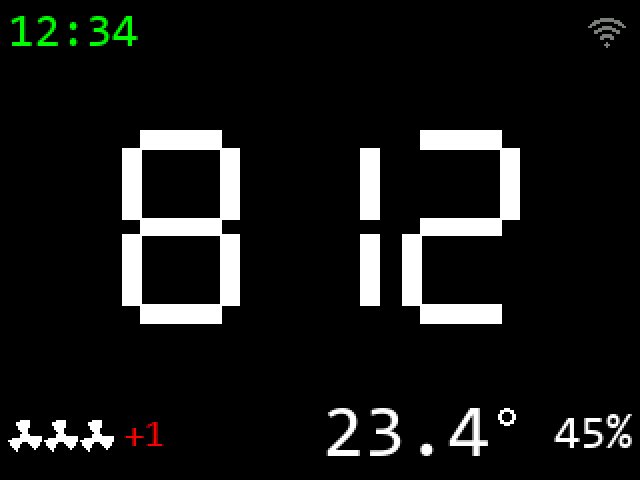
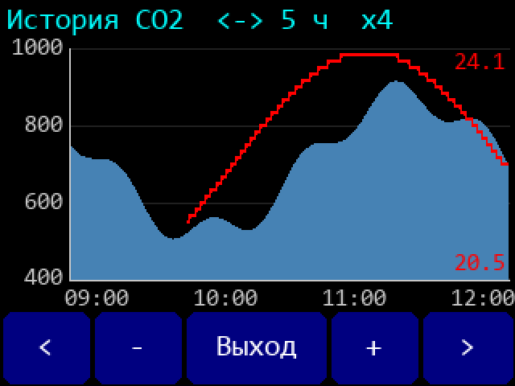

# Беспроводной датчик CO2 (ESP32-S3 + SenseAir K22-OC или S8 LP + nRF24L01+)

> Описание проекта: назначение, железо, распиновка, протокол радиообмена, архитектура прошивки,
> структура репозитория, корпус и открытые вопросы.

<p>


</p>

*Главный экран ES3C28P и график истории CO2 / температуры (макет, `python Scripts/ui_mockup.py`; все экраны - §8).*

<!-- toc -->

**Оглавление**

- [1. Назначение](#1-назначение)
  - [1.1 Старая система](#11-старая-система)
  - [1.2 Новое устройство = датчик + хаб](#12-новое-устройство--датчик--хаб)
- [2. Аппаратная платформа](#2-аппаратная-платформа)
  - [2.1 Выбор платы](#21-выбор-платы)
  - [2.2 ES3C28P - ключевые факты](#22-es3c28p---ключевые-факты-схема)
  - [2.3 T-Display-S3 - ключевые факты](#23-t-display-s3---ключевые-факты-картинка-таблица)
- [3. Распиновка устройства (реализована в config.h)](#3-распиновка-устройства-реализована-в-configh)
  - [3.1 ES3C28P](#31-es3c28p)
  - [3.2 T-Display-S3](#32-t-display-s3)
- [4. Электрическая схема](#4-электрическая-схема)
  - [4.1 Внешнее питание 5 V (без USB)](#41-внешнее-питание-5-v-без-usb)
- [5. Как работает прошивка](#5-как-работает-прошивка)
- [6. Датчик CO2: K22-OC (I2C) или S8 LP (UART)](#6-датчик-co2-k22-oc-i2c-или-s8-lp-uart)
  - [6.1 SenseAir S8 LP по UART](#61-senseair-s8-lp-по-uart)
  - [6.2 SenseAir K22-OC по I2C](#62-senseair-k22-oc-по-i2c-гайд)
  - [6.3 Датчик температуры: DS18B20 или SHT40 (необязательно)](#63-датчик-температуры-ds18b20-или-sht40-необязательно)
- [7. Радиосвязь с вентиляторами nRF24L01+: два режима](#7-радиосвязь-с-вентиляторами-nrf24l01-два-режима)
  - [7.1 Пассивный режим подробно (по Old/CO2UART/app/wireless_co2.c)](#71-пассивный-режим-подробно-по-oldco2uartappwireless_co2c)
  - [7.2 Сверка регистров](#72-сверка-регистров)
- [8. Экран, тачскрин, меню (спецификация - править здесь, затем код)](#8-экран-тачскрин-меню-спецификация---править-здесь-затем-код)
  - [8.1 Общие элементы](#81-общие-элементы)
  - [8.2 Экран запуска](#82-экран-запуска)
  - [8.3 Калибровка тачскрина (только ES)](#83-калибровка-тачскрина-только-es)
  - [8.4 Главный экран](#84-главный-экран)
  - [8.5 Меню настроек](#85-меню-настроек)
  - [8.6 График истории CO2 и температуры](#86-график-истории-co2-и-температуры)
  - [8.7 Структура меню настроек](#87-структура-меню-настроек)
- [9. Веб-интерфейс](#9-веб-интерфейс)
  - [9.1 Страницы](#91-страницы)
  - [9.2 Устройство страниц](#92-устройство-страниц)
  - [9.3 API](#93-api)
  - [9.4 Пароль настроек](#94-пароль-настроек)
  - [9.5 Кодирование строк](#95-кодирование-строк)
  - [9.6 Проверка без платы](#96-проверка-без-платы)
  - [9.7 Отличия от веба хаба](#97-отличия-от-веба-хаба)
- [10. Настройки (NVS, hub_config.h)](#10-настройки-nvs-hub_configh)
  - [10.1 Совместимость настроек при обновлении прошивки](#101-совместимость-настроек-при-обновлении-прошивки)
  - [Wi-Fi: имя и пароль по умолчанию](#wi-fi-имя-и-пароль-по-умолчанию)
- [11. Структура репозитория](#11-структура-репозитория)
  - [Сборка и прошивка](#сборка-и-прошивка)
  - [Скрипты](#скрипты-scripts)
- [12. Корпус (на стену или на стол) - ES3C28P, T-Display-S3 (+ варианты с S8 LP)](#12-корпус-на-стену-или-на-стол---es3c28p-t-display-s3--варианты-с-s8-lp)
  - [12.1 Общая компоновка (вид спереди, экран горизонтально, USB-C слева)](#121-общая-компоновка-вид-спереди-экран-горизонтально-usb-c-слева)
  - [12.2 T-Display-S3: как держится плата](#122-t-display-s3-как-держится-плата)
  - [12.3 Отверстия, щели и заужения](#123-отверстия-щели-и-заужения)
  - [12.4 Крепёж](#124-крепёж)
  - [12.5 Печать без поддержек и допущения](#125-печать-без-поддержек-и-допущения)
  - [12.6 Вариант T-Display-S3 + SenseAir S8 LP (`TDisplayS3_S8`, компактный, приоритет - на стену)](#126-вариант-t-display-s3--senseair-s8-lp-tdisplays3_s8-компактный-приоритет---на-стену)
  - [12.7 Вариант ES3C28P + SenseAir S8 LP (`ES3C28P_S8`, мелкий)](#127-вариант-es3c28p--senseair-s8-lp-es3c28p_s8-мелкий)
- [13. Лицензия](#13-лицензия)

<!-- /toc -->


---

## 1. Назначение

Устройство измеряет концентрацию CO2 датчиком **SenseAir K22-OC** (I2C) или **SenseAir S8 LP** (UART) -
выбор `CO2_SENSOR` в config.h, см. §6, - показывает её на экране
крупными цифрами и по радио **nRF24L01+** рассылает удалённым блокам управления вентиляторами
(проветривателями) команду скорости, рассчитанную по уровню CO2.

Экран (макет главного экрана, меню, графика истории, системных карточек):
[ui_mockup.png](work/png/ui_mockup.png) - генерирует `python Scripts/ui_mockup.py`, подробно - §8.

### 1.1 Старая система

```
 [Датчик AVR ATtiny44A + K22]  --nRF24-->  [Хаб ESP8266 (Wi-Fi, веб, NTP)]  --nRF24-->  [Вентиляторы 1..N]
```

Датчик на AVR отправлял CO2 хабу на ESP8266. **Вентиляторами управлял хаб**: расчёт скорости,
ночной режим, настройки каждого вентилятора, веб-интерфейс, история CO2.

### 1.2 Новое устройство = датчик + хаб

ESP32-S3 сам читает K22 (I2C) и **заменяет хаб**: логика, веб-интерфейс и старый радиопротокол.
Wi-Fi + NTP + веб + история CO2 с графиком.

**Главное требование совместимости:** пакеты к вентиляторам - **побайтно как от хаба ESP8266**.

| Функция | Было (AVR + хаб ESP8266) | Стало (ESP32-S3) |
|---|---|---|
| Чтение CO2 | AVR: ШИМ-выход K22 → nRF24 → хаб | I2C K22 напрямую (адрес 0x68) |
| Расчёт скорости, ночь, коррекции | хаб | тот же алгоритм (§5) |
| Настройки | веб хаба, flash ESP8266 | веб (те же страницы и имена полей) + тачскрин, NVS |
| Время (ночной режим) | SNTP хаба | NTP + часовой пояс POSIX TZ |
| История CO2 + график | RAM хаба, d3 v3 с d3js.org | PSRAM, d3 v7 (облегчённая) **внутри прошивки** |
| Индикация | веб | экран: CO2 крупными цифрами + веб |
| Радио | nRF24, свой драйвер | nRF24L01+ (обычный), **nrf24/RF24 1.6.2**, регистры как у хаба |

> В старом AVR CO2 читался по длительности ШИМ-импульса K22, АЦП - только для фоторезистора.

---

## 2. Аппаратная платформа

### 2.1 Выбор платы

Плата выбирается **окружением PlatformIO** - оно передаёт define, вся распиновка в
[config.h](CO2_Sensor_NRF24/include/config.h) под `#if defined(BOARD_...)`.

| Окружение (`pio run -e`) | Define | Плата | Экран | Ввод | Flash |
|---|---|---|---|---|---|
| `es3c28p` (по умолч.) | `BOARD_ES3C28P` | ESP32-S3 Ai Xiaozhi ES3C28P | ILI9341V 240x320 SPI, IPS | Тач FT6336G + BOOT | **8 МБ** |
| `tdisplay_s3` | `BOARD_TDISPLAY_S3` | LILYGO T-Display-S3 1.9" | ST7789 170x320, 8-бит параллельно | BOOT + IO14 | 16 МБ (по картинке LILYGO) |

Обе платы: модуль ESP32-S3R8 (8 МБ OPI PSRAM), логика 3.3V, USB нативный (прошивка + Serial через USB-CDC).

### 2.2 ES3C28P - ключевые факты ([схема](Docs/2.8inch_ESP32-S3_Display_Schematic.pdf))

- Питание: USB-C 5V → диод Шоттки D8 (B5819W) → цепь +5 → LDO ME6217C33 (3.3V, 800 мА).
  Ток платы: экран ≈140 мА, всё вместе до ≈560 мА.

Занятые на плате GPIO:

| GPIO | Цепь | Назначение |
|---|---|---|
| 0 | IO0 | Кнопка BOOT (KEY2), подтяжка 10k. **Strapping** |
| 1 | AUDIO_EN | Вкл. усилителя FM8002E (активный LOW, подтянут вверх) |
| 4,5,6,7,8 | I2S_MCK, I2S_SCK, I2S_DO, I2S_LRC, I2S_DI | Аудиокодек ES8311 |
| 9 | BAT_ADC | Напряжение батареи /2 |
| 10,11,12,13 | LCD_CS, LCD_MOSI, LCD_SCK, LCD_MISO | Дисплей (SPI2/FSPI) |
| 46 | LCD_RS (D/C) | Дисплей. **Strapping** |
| 45 | LCD_BL | Подсветка (HIGH = вкл). **Strapping**, на плате 10k к GND |
| CHIP_PU | RESET | Сброс ESP32 = сброс LCD |
| 15 / 16 | IIC_SCL / IIC_SDA | I2C0: тач 0x38, кодек 0x18, разъём P4; подтяжки 4.7k к 3V3 |
| 17 / 18 | CTP_INT / CTP_RST | Тач |
| 19, 20 | USB-, USB+ | USB |
| 38-41, 47, 48 | SD_* | MicroSD (SDIO) |
| 42 | RGB_LED | WS2812B |
| 43 / 44 | TXD0 / RXD0 | UART0 → разъём P2 (TXD0 через 499Ω+100Ω, RXD0 через 100Ω) |
| 26-37 | - | Flash / OPI PSRAM - **использовать нельзя** |

Разъёмы (1.25 мм, 4P):

| Разъём | Пин 1 | Пин 2 | Пин 3 | Пин 4 |
|---|---|---|---|---|
| P3 «Expanded IO» | IO2 | IO3 | IO14 | IO21 |
| P4 «IIC» | VCC3V3 | GND | IIC_SCL (GPIO15) | IIC_SDA (GPIO16) |
| P2 «UART» | +5V (через Q5) | GND | TXD0 (GPIO43) | RXD0 (GPIO44) |

### 2.3 T-Display-S3 - ключевые факты ([картинка](Docs/LILYGO%20T-Display%20ESP32-S3.png), [таблица](Docs/LilyGo%20T-Display%20ESP32-S3%20Pinout.docx))

- Дисплей: D0-D7 = 39, 40, 41, 42, 45, 46, 47, 48; WR=8, RD=9, DC=7, CS=6, RES=5, BL=38,
  **LCD_Power_On=15** (HIGH - иначе экран не работает от батареи). Батарея: GPIO4.
- Кнопки: BOOT=GPIO0, IO14.
- Разъём P2 (левый): 3V, 1, 2, 3, 10, 11, 12, 13, NC, NC, GND, 5V.
- Разъём P1 (правый): GND, GND, 43, 44, 18, 17, 21, 16, NC, GND, GND, 3V.
- Штатный I2C платы: SDA=18, SCL=17 (на Touch-версии там тач CST816).
- В таблице .docx GPIO10-13 помечены как strapping - это **ошибка документа**: у ESP32-S3
  strapping только GPIO0, 3, 45, 46.

---

## 3. Распиновка устройства (реализована в config.h)

### 3.1 ES3C28P

В скобках - как написано на плате (шелкография тыльной стороны, Docs/ES3C28P_Size.pdf):
подпись разъёма и имя контакта. Контакт 1 отмечен треугольником.

| Разъём (схема) | Подпись на плате | Контакты 1 … 4 |
|---|---|---|
| P2 | **UART** | 5V, GND, TXD, RXD |
| P3 | (без подписи; на схеме «Expanded IO») | IO2, IO3, IO14, IO21 |
| P4 | **I2C** | 3.3V, GND, IO15(SCL), IO16(SDA) |

| Сигнал | GPIO | Разъём.пин (подпись на плате) | Примечание |
|---|---|---|---|
| K22 SDA | 16 | P4.4 (I2C: IO16(SDA)) | только `CO2_SENSOR_K22`. Общая шина с тачем/кодеком, частота - настройка (по умолч. 100 кГц) |
| K22 SCL | 15 | P4.3 (I2C: IO15(SCL)) | |
| nRF24 SCK | 14 | P3.3 (IO: IO14) | SPI3 (HSPI) через GPIO-matrix; SPI2 занят дисплеем |
| nRF24 MOSI | 21 | P3.4 (IO: IO21) | |
| nRF24 MISO | 3 | P3.2 (IO: IO3) | Strapping (JTAG-sel), вход ESP32 - безопасно |
| nRF24 CSN | 2 | P3.1 (IO: IO2) | не strapping на ESP32-S3; весь SPI nRF24 - на разъёме P3 |
| nRF24 CE | - | **перемычка на 3.3 В** (P4.1) | CE не управляется (обе платы): RF24 в режиме CE == CSN, см. §7 |
| S8 UART_RxD ← ESP TX | 43 | P2.3 (UART: TXD) | только `CO2_SENSOR_S8`. UART1, 9600 8N1; на плате 499R+100R последовательно. При загрузке ROM пишет лог в TXD0 - S8 игнорирует неверные кадры |
| S8 UART_TxD → ESP RX | 44 | P2.4 (UART: RXD) | только `CO2_SENSOR_S8`; S8 целиком на разъёме P2. На плате 100R последовательно; UART0 не используется (Serial через USB-CDC), ROM слушает RXD0 только в режиме прошивки |
| nRF24 VCC / GND | 3V3 / GND | P4.1 / P4.2 (I2C: 3.3V / GND) | + 10-100 мкФ и 0.1 мкФ у модуля |
| DS18B20 DQ | 44 | P2.4 (UART: RXD) | если выбран в настройках и `CO2_SENSOR_K22` (100R на плате 1-Wire не мешает); подтяжка 4.7 кОм DQ → 3.3 В (P4.1). С S8 свободного вывода нет - DS18B20 в настройках недоступен |
| SHT40 SDA / SCL | 16 / 15 | P4.4 / P4.3 (I2C) | если выбран в настройках; общая шина с тачем / K22 (подтяжки 4.7k на плате), питание 3.3 В - P4.1, GND - P4.2 |
| K22 / S8 G+ / G0 | +5V / GND | P2.1 / P2.2 (UART: 5V / GND) | см. §4 про напряжение (S8: 4,5-5,25 V, пик 300 мА) |

### 3.2 T-Display-S3

| Сигнал | GPIO | Разъём | Примечание |
|---|---|---|---|
| K22 SDA | 18 | P1 | только `CO2_SENSOR_K22`. Штатный I2C платы |
| K22 SCL | 17 | P1 | |
| nRF24 SCK | 12 | P2 | SPI2 (FSPI), IO_MUX-пины; дисплей на LCD_CAM, SPI свободен |
| nRF24 MOSI | 11 | P2 | |
| nRF24 MISO | 13 | P2 | |
| nRF24 CSN | 10 | P2 | |
| nRF24 CE | - | **перемычка на 3.3 В** (P2.1 3V3) | CE не управляется (обе платы), GPIO1 (P2.2) свободен, см. §7 |
| S8 UART_RxD ← ESP TX | 43 | P1 (U0TXD) | только `CO2_SENSOR_S8`. UART1 через GPIO-matrix, 9600 8N1 (Serial - через USB-CDC) |
| S8 UART_TxD → ESP RX | 44 | P1 (U0RXD) | только `CO2_SENSOR_S8` |
| nRF24 VCC / GND | 3V / GND | P1/P2 | + конденсаторы у модуля |
| DS18B20 DQ | 1 | P2.2 (GPIO1) | если выбран в настройках; подтяжка 4.7 кОм DQ → 3V (P2.1); свободен: CE nRF24 на перемычке |
| SHT40 SDA / SCL | 18 / 17 | P1 | если выбран в настройках; штатный I2C (с K22 - общая шина). Подтяжки на плате без тача не проверены - если у щупа их нет, 4.7 кОм SDA/SCL → 3V |
| K22 / S8 G+ / G0 | 5V / GND | P2 | см. §4 |

IRQ nRF24 не используется (как в старом проекте - все прерывания замаскированы в CONFIG).

---

## 4. Электрическая схема

```text
   SenseAir K22-OC                                ES3C28P (ESP32-S3)
  ┌─────────────┐                                ┌──────────────────────┐
  │ G+  ◄───────┼──── +5V (P2.1) или внешний ────┤ P2.1 +5V             │
  │ G0  ◄───────┼───────────── GND ──────────────┤ P2.2 / P4.2 GND      │
  │ I2C_SCL ────┼────────────────────────────────┤ P4.3 GPIO15 (4.7k↑)  │
  │ I2C_SDA ────┼────────────────────────────────┤ P4.4 GPIO16 (4.7k↑)  │
  │ DVCC - не подключать                         │                      │
  └─────────────┘                                │                      │
   nRF24L01+                                     │                      │
  ┌─────────────┐  C 10..100 мкФ + 0.1 мкФ       │                      │
  │ VCC ◄───────┼────────────────────────────────┤ P4.1 VCC3V3          │
  │ GND ◄───────┼───────────── GND ──────────────┤ P4.2 GND             │
  │ SCK  ◄──────┼────────────────────────────────┤ P3.3 GPIO14          │
  │ MOSI ◄──────┼────────────────────────────────┤ P3.4 GPIO21          │
  │ MISO ───────┼────────────────────────────────┤ P3.2 GPIO3           │
  │ CSN  ◄──────┼────────────────────────────────┤ P3.1 GPIO2           │
  │ CE   ◄──────┼─────── 3.3 V перемычкой ───────┤ P4.1 VCC3V3          │
  └─────────────┘                                │                      │
   Термометр (один, выбор в настройках):         │                      │
   DS18B20 (только с K22)                        │                      │
  ┌─────────────┐  4.7 кОм: DQ -> 3.3 V          │                      │
  │ VDD ◄───────┼────────────────────────────────┤ P4.1 VCC3V3          │
  │ GND ◄───────┼───────────── GND ──────────────┤ P4.2 GND             │
  │ DQ  ◄►──────┼────────────────────────────────┤ P2.4 GPIO44 (RXD0)   │
  └─────────────┘                                │                      │
   SHT40 (щуп, 4 провода)                        │                      │
  ┌─────────────┐  подтяжки 10k щупа || 4.7k     │                      │
  │ VCC ◄───────┼────────────────────────────────┤ P4.1 VCC3V3          │
  │ GND ◄───────┼───────────── GND ──────────────┤ P4.2 GND             │
  │ SCL ◄───────┼────────────────────────────────┤ P4.3 GPIO15 (I2C,    │
  │ SDA ◄►──────┼────────────────────────────────┤ P4.4 GPIO16  общая)  │
  └─────────────┘                                │ USB-C 5V - питание   │
                                                 └──────────────────────┘
```

Вариант **SenseAir S8 LP** (`CO2_SENSOR_S8`) на ES3C28P - вместо K22; **CE nRF24 - перемычкой на 3.3 V**
(вывод GPIO43 отдан под UART). Не подключать: Alarm_OC, PWM, DVCC_out (3.3 V датчика, ≤ 6 мА), UART_R/T, bCAL_in:

```text
   SenseAir S8 LP (вид на выводы)                 ES3C28P (ESP32-S3)
  ┌─────────────┐                                ┌──────────────────────┐
  │ G+  ◄───────┼─── +5V (P2.1) / внешний 5 V ───┤ P2.1 +5V             │
  │ G0  ◄───────┼───────────── GND ──────────────┤ P2.2 GND             │
  │ UART_RxD ◄──┼────────────────────────────────┤ P2.3 GPIO43 (TXD0)   │
  │ UART_TxD ───┼────────────────────────────────┤ P2.4 GPIO44 (RXD0)   │
  │ остальные - не подключать                    │                      │
  └─────────────┘  C 100 мкФ + 0.1 мкФ у G+/G0   │                      │
   nRF24L01+ (остальное - как выше)              │                      │
  ┌─────────────┐                                │                      │
  │ CE   ◄──────┼─────── 3.3 V перемычкой ───────┤ P4.1 VCC3V3          │
  └─────────────┘                                │                      │
   Термометр: только SHT40 (под DS18B20          │                      │
   свободного вывода нет)                        │                      │
   SHT40 (щуп, 4 провода)                        │                      │
  ┌─────────────┐  подтяжки 10k щупа || 4.7k     │                      │
  │ VCC ◄───────┼────────────────────────────────┤ P4.1 VCC3V3          │
  │ GND ◄───────┼───────────── GND ──────────────┤ P4.2 GND             │
  │ SCL ◄───────┼────────────────────────────────┤ P4.3 GPIO15          │
  │ SDA ◄►──────┼────────────────────────────────┤ P4.4 GPIO16          │
  └─────────────┘                                │ USB-C 5V - питание   │
                                                 └──────────────────────┘
```

**LILYGO T-Display-S3** - номера контактов по таблице LILYGO
([Pinout.docx](Docs/LilyGo%20T-Display%20ESP32-S3%20Pinout.docx)): левый разъём P2 - 1…12, правый P1 - 13…24.
CE nRF24 - перемычкой на 3.3 V (GPIO1 свободен). Датчик - K22-OC **или** S8 LP (`CO2_SENSOR`):

```text
   SenseAir K22-OC  (CO2_SENSOR_K22)              T-Display-S3 (ESP32-S3)
  ┌─────────────┐                                ┌──────────────────────────┐
  │ G+  ◄───────┼── 5V (P2.12) или внешний 5 V ──┤ P2.12 5V (VBUS)          │
  │ G0  ◄───────┼───────────── GND ──────────────┤ P2.11 GND / P1.13 GND    │
  │ I2C_SCL ────┼────────────────────────────────┤ P1.18 GPIO17 (SCL)       │
  │ I2C_SDA ────┼────────────────────────────────┤ P1.17 GPIO18 (SDA)       │
  │ DVCC - не подключать                         │                          │
  └─────────────┘                                │                          │
   SenseAir S8 LP  (CO2_SENSOR_S8)               │                          │
  ┌─────────────┐  C 100 мкФ + 0.1 мкФ у G+/G0   │                          │
  │ G+  ◄───────┼── 5V (P2.12) или внешний 5 V ──┤ P2.12 5V                 │
  │ G0  ◄───────┼───────────── GND ──────────────┤ P1.14 GND                │
  │ UART_RxD ◄──┼────────────────────────────────┤ P1.15 GPIO43 (U0TXD)     │
  │ UART_TxD ───┼────────────────────────────────┤ P1.16 GPIO44 (U0RXD)     │
  │ остальные - не подключать                    │                          │
  └─────────────┘                                │                          │
   nRF24L01+                                     │                          │
  ┌─────────────┐  C 10..100 мкФ + 0.1 мкФ       │                          │
  │ VCC ◄───────┼────────────────────────────────┤ P2.1  3V3                │
  │ GND ◄───────┼───────────── GND ──────────────┤ P2.11 GND                │
  │ SCK  ◄──────┼────────────────────────────────┤ P2.7  GPIO12             │
  │ MOSI ◄──────┼────────────────────────────────┤ P2.6  GPIO11             │
  │ MISO ───────┼────────────────────────────────┤ P2.8  GPIO13             │
  │ CSN  ◄──────┼────────────────────────────────┤ P2.5  GPIO10             │
  │ CE   ◄──────┼─────── 3.3 V перемычкой ───────┤ P2.1  3V3                │
  └─────────────┘                                │                          │
   Термометр (один, выбор в настройках):         │                          │
   DS18B20                                       │                          │
  ┌─────────────┐  4.7 кОм: DQ -> 3V             │                          │
  │ VDD ◄───────┼────────────────────────────────┤ P2.1  3V3                │
  │ GND ◄───────┼───────────── GND ──────────────┤ P2.11 GND                │
  │ DQ  ◄►──────┼────────────────────────────────┤ P2.2  GPIO1              │
  └─────────────┘                                │                          │
   SHT40 (щуп, 4 провода)                        │                          │
  ┌─────────────┐  4.7 кОм SDA,SCL -> 3V *       │                          │
  │ VCC ◄───────┼────────────────────────────────┤ P1.24 3V                 │
  │ GND ◄───────┼───────────── GND ──────────────┤ P1.23 GND                │
  │ SCL ◄───────┼────────────────────────────────┤ P1.18 GPIO17 (общая      │
  │ SDA ◄►──────┼────────────────────────────────┤ P1.17 GPIO18  с K22)     │
  └─────────────┘                                │ USB-C 5V - питание       │
                                                 └──────────────────────────┘
```

\* Подтяжки I2C T-Display-S3 (GPIO17/18): на плате не проверены. Если у щупа SHT40 свои (часто 10 кОм) -
на коротком кабеле хватит; на кабеле около 1 м или если щуп без подтяжек - 4.7 кОм с SDA и SCL на 3V
(вместе с 10 кОм щупа ≈3.2 кОм). Общая земля щупа и платы.

Особенности T-Display-S3: GPIO43/44 выведены ещё и на нижний 4-контактный разъём JST; при загрузке ROM пишет
лог в U0TXD (GPIO43) - S8 игнорирует неверные кадры. GPIO10-13 по таблице LILYGO помечены strapping, но для
ESP32-S3 strapping - 0, 3, 45, 46; GPIO10-13 - выводы FSPI (IO_MUX), используются как SPI. Питание через
P2.12 «5V» - это сама линия VBUS, см. §4.1 (не подключать одновременно USB).

Проверка схемы:

1. **Логические уровни:** DVCC K22 = 3.3V (гайд SenseAir) - I2C совместим с ESP32-S3 напрямую.
   S8 LP: UART - КМОП 3,3 V (лог. 1 вход ≥ 2,3 V, выход ≥ 2,4 V; [спецификация](Docs/Senseair%20S8%20LP%20product%20specification.md)) - напрямую.
   nRF24L01+ - 3.3V. Конвертеры не нужны.
2. **Питание K22-OC:** допустимо **4.5-12 V**. На ES3C28P цепь +5 = VBUS минус диод Шоттки D8
   (≈0.3-0.4 В) и далее Q5 → на P2.1 ожидается ≈4.6 В - **на границе допуска**. Измерить под
   нагрузкой (K22 потребляет импульсно при вспышке лампы). Если < 4.75 В - питать K22 от
   внешнего источника 5-12 V (как в старой схеме 9 V), объединив GND.
3. **Токи:** nRF24L01+ без PA/LNA - ≈12 мА TX. От LDO платы (800 мА) - с запасом.
   **S8 LP: питание 4,5-5,25 V (уже, чем у K22), пик 300 мА**, среднее < 18 мА; без защиты от переполюсовки.
   От USB через D8 на P2.1 ≈4,6 V - в допуске, но близко к нижней границе: при сбоях - внешний БП 5 V (§4.1).
4. **Общая земля:** GND внешнего БП (если есть), платы, K22, nRF24 и термометра - **объединить**.
5. **Strapping-пины:** затронут только GPIO3 (MISO, вход ESP32; nRF драйвит MISO только при CSN=LOW).
   GPIO2 (CSN nRF24) и GPIO1 (DQ DS18B20 на T-Display) на ESP32-S3 не strapping
   (strapping: 0, 3, 45, 46).
6. **Подтяжки I2C на T-Display-S3:** на плате без тача наличие подтяжек на 17/18 не
   документировано. K22 имеет свои подтяжки к DVCC 3.3V (гайд, рис. 1); при сбоях - добавить
   4.7k к 3V3.
7. **Термометры:** DS18B20 и SHT40 питать **только от 3.3 V** (SHT40 - не выше 3,6 V), подтяжки DQ / SDA / SCL -
   тоже к 3.3 V: на 5 V выводы ESP32-S3 и тач на общей шине получили бы 5 V. DS18B20 - не в паразитном
   питании (VDD подключён). Ток: DS18B20 до 1,5 мА при измерении, SHT40 ≈0,5 мА - от 3.3 V платы с запасом.
   Подтяжки щупа SHT40 (обычно 10 кОм) параллельно 4.7 кОм ES3C28P дают ≈3.2 кОм - ток ≈1 мА, в норме I2C (≤ 3 мА).

### 4.1 Внешнее питание 5 V (без USB)

**ES3C28P - вход на разъёме P2 «UART», контакт 1 (5V), GND - контакт 2.** По схеме это
штатный вход питания с защитой от переполюсовки: P2.1 → Q5 (P-MOSFET SL2305, затвор через R40
10k на GND) → цепь +5 → LDO ME6217 (3.3 V) и остальная 5-вольтовая периферия.

```
БП 5 V (+) ──┬── P2.1 «5V»  (UART-разъём платы)
             └── K22 G+     (отдельным проводом прямо от БП - без диода D8: полные 5 V)
БП GND ──────┬── P2.2 «GND»
             └── K22 G0
```

| Требование | Значение |
|---|---|
| Напряжение | **5,0 V (4,75-5,5 V)**: на +5 висят LDO (вход до 6,5 V), зарядник TP4054, светодиод WS2812, усилитель - больше 5,5 V не подавать |
| Ток БП | **не меньше 1 А**: экран ≈140 мА, Wi-Fi до ≈350 мА в пиках, K22 импульсно при вспышке лампы, nRF24 |
| Провод | разъём 1,25 мм (до ≈1 А на контакт) - для этого достаточно; K22 запитать **отдельным проводом от БП**, а не через плату |

**Обязательно:**

1. **Аккумулятор (JP1) не подключать при питании через P2.** Ключ Q3 подключает батарею к цепи
   +5, когда на USB нет VBUS. При питании через P2 VBUS отсутствует → Q3 открыт → внешние 5 V
   попадают прямо на Li-Po **в обход контроллера заряда** (перезаряд, опасно).
2. USB одновременно с P2 подключать можно: диод D8 не даёт внешним 5 V уйти в USB компьютера.
3. Общая земля БП, платы, K22 и nRF24.

Плюс этого варианта: K22-OC получает полные 5 V от БП (вопрос «на границе допуска» из п. 2 выше
снимается - там 4,6 V было из-за диода D8 при питании от USB).

**T-Display-S3** - контакт **5V** на левом разъёме P2 (по таблице LILYGO: «5V (VBUS) input/output»,
то есть это сама линия VBUS). Схемы платы в Docs нет - **защиты от переполюсовки и от обратного
тока в USB не проверить**: при питании через 5V не подключать одновременно USB, полярность -
внимательно.

Старая схема для справки: [Old/WirelessCO2Sensor.png](Old/WirelessCO2Sensor.png).

---


## 5. Как работает прошивка

`loop()` неблокирующий (конечные автоматы на `millis()`, блокирующий `delay()` - только в `setup()`); в конце
прохода - уступка ядра планировщику `vTaskDelay(LOOP_YIELD_TICKS)` (1 мс, вне `CfgLock`): без неё `loop()` крутится
непрерывно и ядро 1 занято на 100 % вхолостую.
Веб-сервер (`esp_http_server`) - в своей задаче FreeRTOS; общие данные (настройки и
состояние) защищены рекурсивным мьютексом `Cfg::lock()` / `CfgLock`.

```
setup(): Serial(USB-CDC) → SysInfo → настройки из NVS → история (буферы в PSRAM)
       → дисплей/тач → датчик CO2 (I2C K22 / UART S8) → nRF24 (RF24) + сверка регистров
       → FanControl → Wi-Fi/NTP → веб-сервер → экран запуска 5 с
loop():  Net::update → [под CfgLock] SysInfo::update → Co2Sensor::update → TempSensor::update
       → History::setTemp → FanControl::update (запись в историю) → Ui::update
```

1. **Co2Sensor** ([co2_sensor.h](CO2_Sensor_NRF24/src/co2_sensor.h)) - общий интерфейс, реализация по `CO2_SENSOR`:
   - **K22-OC** ([k22.cpp](CO2_Sensor_NRF24/src/k22.cpp)) - раз в 2 с: запрос ReadRAM → пауза 20 мс →
     чтение 4 байт, до 5 повторов при «не готов»/NACK;
   - **S8 LP** ([s8.cpp](CO2_Sensor_NRF24/src/s8.cpp)) - раз в 2 с Modbus-запрос «статус + CO2» (IR1…IR4),
     ответ 13 байт до 250 мс, проверка адреса, функции, длины и CRC; ошибки датчика по MeterStatus.

   Нет валидных данных 10 с → ошибка датчика. Тип датчика (`CO2_SENSOR_NAME`) - на экране запуска, в меню
   «О программе», в вебе (страница «Инфо», подвал) и в Serial.
2. **FanControl** ([fan_control.cpp](CO2_Sensor_NRF24/src/fan_control.cpp)) - перенос
   `wireless_co2.c` хаба. Раз в `transmitPeriodS` (20 с по умолч.; первый раз через 5 с,
   только при валидных данных K22):
   - CO2 → кольцевой буфер **6** значений (`CO2_Averaging`), запись в историю;
   - `CO2_set_fans_speed_current`: скорость 0..6 = первый порог (ppm), где `среднее < порог`;
     при снижении - только если `порог − среднее ≥ speedDelta`; `+ speedOverride`, 0..6;
     ночь (по расписанию будни/выходные или ручной переключатель) → `≤ nightMaxSpeed`;
   - для каждого вентилятора без FORCED: коррекция день/ночь (`=`, `+`, `≤`, `≥`),
     ограничение `speedMin..speedMax` → `speedCurrent`;
   - рассылка всем, кроме SKIP: свой канал и адрес, пакет `{CO2, speedCurrent, 0}`;
   - раз в 1 с: таймауты принудительной скорости (по нулю флаг FORCED снимается).
3. **Radio** ([radio.cpp](CO2_Sensor_NRF24/src/radio.cpp)) - неблокирующая передача
   (`startFastWrite()` + опрос STATUS, таймаут 50 мс); канал пишется только при смене.
4. **Net** ([net.cpp](CO2_Sensor_NRF24/src/net.cpp)) - Wi-Fi; NTP + TZ; mDNS `http://co2.local`.
   Режимы (`Net::Mode`):
   - режим Wi-Fi (`net.wifiMode`) - **только на экране** «Система → Wi-Fi»: **выкл** (по умолчанию) / **вкл** /
     **часы**:
     - **выкл** → радио Wi-Fi выключено (`WIFI_OFF`), веба и NTP нет - `Off`;
     - **часы** → Wi-Fi только для времени: окно синхронизации - станция к роутеру (SSID и пароль из
       настроек, заданных в режиме «вкл»), после подключения сразу запрос NTP; время пришло или прошло
       `WIFI_CLOCK_WINDOW_MS` (60 с) - радио выключается. Следующее окно: после удачи - через
       `net.ntpPeriodMin` (по умолчанию 1440 мин - раз в сутки), после неудачи - через `WIFI_CLOCK_RETRY_MS` (10 мин).
       Точки доступа и веба нет; между окнами SNTP остановлен. Состояние - карточка «Сеть Wi-Fi»;
     - **вкл** → ниже. Веб-сервер запускается при первом включении режима «вкл»;
   - SSID не задан → **только точка доступа** (`net.apSsid` / `net.apPass`, по умолчанию `CO2-Hub` / `co2sensor`,
     меняются в вебе; 192.168.4.1) - `AccessPoint`;
   - SSID задан → станция (`Connecting` → `Station`). Если связи с роутером нет - не подключилось
     после старта или смены настроек, или пропала - дольше `net.apDelayMin` (по умолчанию
     **10 мин**, 1…1440, веб «Настройки») → **AP+STA** (`StationAndAp`): точка доступа для
     настройки, станция продолжает попытки. Связь появилась → AP выключается, при следующей потере
     отсчёт начинается заново;
   - **поиск роутера - только по своему таймеру:** при потере связи сразу, затем раз в
     `WIFI_RETRY_MS` (**1 мин**). Автоповтор ядра выключен (`setAutoReconnect(false)`): он искал бы
     роутер непрерывно (новая попытка сразу после неудачной), а ещё не повторяет после `AUTH_FAIL`
     (неверный пароль, временный отказ роутера);
   - **пока к точке доступа кто-то подключён** (`softAPgetStationNum() > 0`, проверка раз в 1 с) -
     поиск не запускается, а начатая попытка прерывается: при поиске по каналам точка доступа
     переключается вместе со станцией и клиент теряет связь. Клиент ушёл - поиск сразу, затем раз в
     минуту. Исключение - сохранение новой сети в вебе: попытка запускается сразу;
   - смена настроек при работающей AP (через неё их и меняют) AP не выключает - она остаётся до
     появления связи, чтобы ошибка в SSID/пароле не лишила доступа;
   - **«Забыть сеть»** (веб, `net_forget=1`) - стирает SSID и пароль → только точка доступа.
     Это и есть отмена подключения;
   - восстановление связи после короткого сбоя - до 1 мин (раньше ядро переподключалось сразу).

   **Время:**
   - **NTP и часовой пояс** - сервер `net.ntp` (по умолч. `pool.ntp.org`) и POSIX TZ `net.tz` (`MSK-3`),
     веб «Настройки» → «Сеть». `configTzTime()` при старте и после «Сохранить и переподключиться»:
     первая синхронизация - сразу, как только есть сеть (всегда), дальше - раз в `net.ntpPeriodMin`
     (**1440 мин - раз в сутки** по умолч., 1…10080; `sntp_set_sync_interval()` перед запуском SNTP).
   - **Ручная установка** - веб «Настройки» → «Часы»: поле даты/времени (местное время браузера) +
     «Установить» или «Время компьютера»; на устройство уходит UTC, с (`sys_time_set`) →
     `Net::setTimeManual()` → `settimeofday()`. Работающий NTP при следующей синхронизации вернёт своё время.
   - Источник времени (`Net::timeSource()`: NTP / вручную) - в `sntp_status`.
   - **Аптайм** (`Net::uptimeS()`) - монотонные секунды от включения из 64-битного `esp_timer_get_time()`
     (не `millis()`, который переполняется через 49,7 суток). События и история хранят аптайм, а
     **реальное время считается назад от текущих часов:** время = сейчас − (аптайм сейчас − аптайм события)
     (`Net::epochFromUptime`). Поэтому подводка часов (NTP или вручную) сразу видна во всей истории,
     смещение хранить и корректировки отслеживать не нужно; записи до первой установки времени тоже
     получают правильные даты (пока время не установлено - без дат, ось графика «−N мин»).
     Время включения (`sys_mactime`) = сейчас − аптайм.
5. **Web** ([web.cpp](CO2_Sensor_NRF24/src/web.cpp)) - см. §9.
6. **History** ([history.h](CO2_Sensor_NRF24/src/history.h) - подробное описание,
   [history.cpp](CO2_Sensor_NRF24/src/history.cpp)) - история для графика экрана, `history.htm` и `history.csv`.
   - **Два кольцевых буфера одинаковой длины** (оба в PSRAM; без PSRAM - во внутренней RAM):
     - **CO2** - запись {аптайм, с; CO2, ppm}, **6 байт**;
     - **температура** - 0,1 °C, **2 байта** (`HISTORY_NO_TEMP` - в этот момент данных не было).
   - **Параллельные:** общий указатель записи; ячейка k буфера температуры - температура в момент записи
     ячейки k буфера CO2 (своего времени у температуры нет). Полный буфер - новая запись затирает самую старую.
   - **Запись** - раз в период рассылки (`transmitPeriodS`, это и шаг графика): CO2 и последнее достоверное
     значение датчика температуры (§6.3) в один момент.
   - **Размер - в сутках** (`historyDays`, 1…365, по умолч. 7): записей = сутки × 86400 / период
     (не меньше 100).
   - **Автоограничение по памяти:** при выделении - не больше, чем помещается в самый большой свободный
     блок PSRAM минус 64 КБ (без PSRAM - внутренней RAM минус 96 КБ), из расчёта 8 байт на запись (CO2 +
     температура - чтобы буфер температуры влез и позже). Заказано больше - выделяется сколько влезет
     (`hist_cap` < `hist_wanted`; меню «влезет N сут», веб «Инфо» - «ограничено памятью»).
   - **Выделение и очистка:**
     - буфер CO2 - при старте и при смене срока или периода (меню - при выходе, веб - при сохранении):
       `History::configure()` пересоздаёт оба буфера, **история очищается**;
     - буфер температуры - пока выбран датчик температуры (`History::setTemp()` из `loop()`); ячейки за
       время до выбора - «нет данных»; выбор снят - буфер освобождается.
   - **Шкала температуры** на графике экрана - мин..макс видимого окна + по 1/10 диапазона сверху и снизу
     (не меньше 1 °C), линия не выходит за поле графика; на веб-странице «История» - по всему буферу.
   - **Время записей** - назад от текущих часов (п. 4, «Время»).
   - **Память и записи** - веб «Инфо» (буферы: занято б/Кб/Мб, записей, вмещает) и меню «Система» →
     «Состояние системы».
   - Ограничение: история в RAM, после перезагрузки начинается заново.
7. **Ui** ([ui.cpp](CO2_Sensor_NRF24/src/ui.cpp)) - экран и меню (§8).
8. **TempSensor** ([temp_sensor.cpp](CO2_Sensor_NRF24/src/temp_sensor.cpp)) - датчик температуры (нет /
   DS18B20 / SHT40, выбор в настройках), §6.3.
9. **SysInfo** ([sys_info.cpp](CO2_Sensor_NRF24/src/sys_info.cpp)) - состояние системы:
   - **задачи FreeRTOS:** встроенная статистика Arduino-ESP32 3.x (`CONFIG_FREERTOS_USE_TRACE_FACILITY`,
     `GENERATE_RUN_TIME_STATS`, счётчик - `esp_timer`, мкс, 32 бита): раз в 2 с `uxTaskGetSystemState()` в
     статический массив (`SYSINFO_TASKS_MAX` = 32). Время задачи накапливается в 64 бита по приращениям
     (32-битный счётчик переполняется раз в ~71,6 мин); «Итого» - доля от суммы времени всех задач (оба ядра)
     с запуска. **Мин. свободный стек - в байтах** (`StackType_t` в ESP-IDF - `uint8_t`); меньше
     `TASK_STACK_WARN_B` (512 Б) - красным. Порядок - по убыванию приоритета, затем по имени;
   - **загрузка ядер** - 100 % − доля задачи простоя ядра (IDLE0 / IDLE1) за последний период (раньше, в
     Arduino 2.x без статистики задач, - обработчиком тика; убран);
   - **температура кристалла** - встроенный датчик ESP32-S3 (`temperatureRead()`), раз в 2 с; это
     температура чипа (выше комнатной на 10-30 °C);
   - снимок - в `loop()` **под `CfgLock`**: веб собирает JSON под тем же замком, отдельный мьютекс не нужен;
   - показ: веб «Инфо» → «Процессор», «Задачи FreeRTOS» (таблица: задача, состояние, приоритет, ядро, стек мин.,
     время, итого); меню «Система» → «Состояние системы», **«Задачи FreeRTOS»** (§8.7).
10. **ErrLog** ([errlog.cpp](CO2_Sensor_NRF24/src/errlog.cpp)) - **журнал ошибок**: кольцевой буфер в RAM
    (`ERRLOG_BYTES` = 4 Кб, запись 16 байт - до 256 записей), после перезапуска пуст.
    - Запись: время первого раза (аптайм; показывается датой и временем, до установки часов - «+0:01:02» от
      включения), устройство, код ошибки, аргумент; расшифровка - при выводе.
    - **Та же ошибка** (устройство, код, аргумент) среди последних `ERRLOG_MERGE_DEPTH` (16) записей новой записи
      не создаёт: растут счётчик и время последнего раза - датчик, молчащий при каждом опросе, журнал не вытесняет.
    - Что пишется: датчик CO2 (нет ответа, неверный ответ, исключение Modbus, статус датчика ≠ 0, нет данных дольше
      3 периодов), датчик температуры (все ошибки чтения), nRF24 (не найден при запуске + что вернул по SPI;
      несовпавшие регистры после перенастройки), вентиляторы (нет ACK, передача не завершилась, адрес не
      записался, молчит дольше тайм-аута, сообщил ошибку связи, сбой EEPROM). Новая запись - и в Serial.
    - Показ: меню «Система» → «Журнал ошибок» (§8.7), веб «Инфо» (`/errlog.txt`, §9.3).

Внеочередная рассылка (`send_fans_speed_now`): коррекция вентилятора «+/−/*» (только он);
изменение поправки, ночи, порогов, количества вентиляторов (все).

---

## 6. Датчик CO2: K22-OC (I2C) или S8 LP (UART)

Выбор - `CO2_SENSOR` в [config.h](CO2_Sensor_NRF24/include/config.h) (`CO2_SENSOR_K22` / `CO2_SENSOR_S8`,
**по умолчанию K22**) или `-DCO2_SENSOR=1|2` в build_flags. Остальная прошивка от датчика не зависит
(интерфейс `Co2Sensor`).

| | K22-OC | S8 LP (004-0-0053) |
|---|---|---|
| Интерфейс | I2C 0x68, ≤ 100 кГц | UART Modbus RTU, 9600 8N1, адрес 0xFE |
| Диапазон | по спецификации K22-OC (в Docs нет) | **400…2000 ppm** (по UART до 10 000 с худшей точностью) |
| Период измерения | в Docs нет | 4 с |
| Опрос в прошивке | 2 с | 2 с |
| Питание | 4,5-12 V | **4,5-5,25 V**, пик 300 мА |
| Габариты | 64,8 × 59,7 × ~37 мм | 33,9 × 19,8 × 8,7 мм |
| Документы | [I2C гайд](Docs/SensAir_I2C_comm_guide_2_1031.pdf) | [спецификация](Docs/Senseair%20S8%20LP%20product%20specification.md), [Modbus](Docs/Senseair%20S8%20Modbus.md) (оцифровки PDF) |

Корпус (§12) пока рассчитан на K22; под S8 - отдельная компоновка (не сделана).

### 6.1 SenseAir S8 LP по UART

- Датчик измеряет раз в **4 с** (спецификация, не настраивается); опрос - **настройка** «Период чтения CO2»
  (`co2.co2PollS`, по умолч. 2 с - статус рекомендовано читать раз в 2 с): `FE 04 00 00 00 04 E5 C6` - IR1…IR4 (статус и CO2 одним запросом).
- Ответ: `FE 04 08 [IR1 статус] [IR2] [IR3] [IR4 CO2] CRC` (13 байт, CRC младшим байтом первым), таймаут 250 мс
  (по спецификации ≤ 180 мс). Неверная длина/CRC, исключение Modbus или таймаут - ошибка обмена.
- MeterStatus (IR1): биты Fatal / Offset / Algorithm / Output / Self-diag / Memory (`S8_STATUS_ERRORS` = 0x5F) -
  данные не валидны; Out of range (0x20) - показание используется. Статус с расшифровкой битов («0x20: вне
  диапазона») - в вебе («Настройки → История и датчики → Датчик CO2») и в журнале ошибок (§5).
- Ошибки опроса - в журнал ошибок: нет ответа, неверный ответ (длина / CRC), исключение Modbus (код), ошибка
  датчика (статус), нет данных дольше 3 периодов. На экране - в шапке, после 5 неудачных опросов
  подряд (`UI_FAULT_READS`; любая ошибка, в журнал - каждая): «CO2: нет связи», «CO2: сбой обмена», «CO2: ERR Mdb-3»
  (исключение Modbus 3), «CO2: ERR x01» (статус).
- CRC-16 Modbus проверен на 4 примерах из спецификации (запросы и ответы).
- **ABC** (HR32 ABC Period, часы; 0 - ABC приостановлен; по умолчанию 192 ч = 8 сут): читается и пишется из веба
  («Настройки → ABC датчика», §9): чтение - функция 0x03, запись - 0x06 (ответ - эхо запроса), после записи
  перечитывается. Вкл/выкл и период - один регистр: выкл - записать 0, вкл - записать период.
- Фоновая калибровка (HR2 = 0x7C06) в прошивке не используется.

### 6.2 SenseAir K22-OC по I2C ([гайд](Docs/SensAir_I2C_comm_guide_2_1031.pdf))

- Датчик измеряет раз в **2 с** - опрос - настройка «Период чтения CO2» (`co2.co2PollS`, по умолч. 2 с).
  «Нет датчика» (оба датчика) - нет верных данных дольше `CO2_FAIL_PERIODS` (3) периодов опроса.
  Период измерения самого датчика не настраивается; настраивается
  только фильтрация показаний (биты MeterControl, гайд гл. 8.5) - прошивка её не трогает.
- Адрес **0x68**, SCL **≤ 100 кГц** (гайд, табл. 5: настройка «Частота шины I2C» в сборке с K22 - не выше 100), возможен clock stretching и NACK, когда датчик занят.
- Запрос: `[0xD0] 0x22 0x00 0x08 0x2A` (ReadRAM 2 байта с 0x0008; checksum = сумма байт без адреса I2C).
- Ответ после tWAIT ≈ 20 мс: `[0xD1] status, CO2_hi, CO2_lo, checksum`; `status.bit0 = 1` - готово;
  checksum = младший байт суммы трёх предыдущих. CO2 - signed int16 (отрицательные → 0).
- На ES3C28P шина общая с тачем → K22 читается через I2C-драйвер **LovyanGFX** (`lgfx::i2c`),
  тот же, что у тача. Arduino `Wire` не используется.
- Ответ проверяется: бит «выполнено», команда в старшем полубайте статуса (= команде запроса), checksum.
- После каждого удачного чтения CO2 читается **Error Status** (RAM 0x1E, 1 байт; 0 - без ошибок, гайд табл. 11).
  Значение битов гайд относит к документации продукта, для K22 её в Docs нет - выводится кодом («ошибка датчика
  0x04»). Ошибки (нет ответа, неверный ответ, Error Status ≠ 0, нет данных) - в журнал ошибок и в шапку экрана,
  как у S8 («CO2: ERR x04»); опрос удачен, только если и CO2, и Error Status = 0.
- **ABC** (гайд, гл. 8.4; текст гайда - `work/SensAir_I2C_comm_guide_2_1031.txt`) - из веба («Настройки → ABC
  датчика», §9), между опросами CO2:
  - сначала проверяется карта памяти (RAM 0x2F): адреса ниже даны для карт **0x09 / 0x0A**, иначе - ошибка;
  - период - EEPROM **0x40**, 2 байта, старший первым, часы (команды Read EE `0x4n` / Write EE `0x3n`);
  - вкл/выкл - бит 1 байта **MeterControl** (EEPROM **0x3E**; 1 - выключено): чтение - изменение бита - запись;
    **действует после перезапуска питания датчика** (адрес копии в RAM гайд не приводит);
  - после записи оба значения перечитываются. K22 без EEPROM на эти команды не отвечает - ошибка «нет ответа».

### 6.3 Датчик температуры: DS18B20 или SHT40 (необязательно)

- **Выбор - в настройках** (меню «История и датчики» → «Датчик температуры», веб «Настройки»):
  **нет** (по умолчанию) / **DS18B20** / **SHT40**; применяется сразу, без перезапуска. DS18B20 предлагается,
  только если есть вывод (`TEMP_PIN_DQ` ≥ 0: ES3C28P с K22 - GPIO44 (P2.4), T-Display - GPIO1; ES3C28P + S8 - нет).
- Период чтения `tempPeriodS` - **10 с** по умолчанию, 1…60 (меню и веб). 3 ошибки подряд - значение
  недостоверно (на экране серые «--.-»). Код: [temp_sensor.cpp](CO2_Sensor_NRF24/src/temp_sensor.cpp) - выбор
  драйвера, период, учёт ошибок; драйверы [ds18b20.cpp](CO2_Sensor_NRF24/src/ds18b20.cpp),
  [sht40.cpp](CO2_Sensor_NRF24/src/sht40.cpp) с общим интерфейсом [temp_backend.h](CO2_Sensor_NRF24/src/temp_backend.h).
- **Неблокирующие:** за вызов - один короткий шаг обмена (≤ ~0,6 мс), ожидание измерения - по `millis()`.

**DS18B20 (1-Wire, только температура)**

- DQ + подтяжка **4.7 кОм к 3.3 В**, VDD - 3.3 В (не паразитное питание), GND общий; один датчик (SKIP ROM).
- Цикл: сброс → SKIP ROM → CONVERT T → **750 мс** → сброс → SKIP ROM → READ SCRATCHPAD → 9 байт.
- Проверки: **CRC-8** (x⁸+x⁵+x⁴+1), регистр конфигурации (бит 7 = 0, биты 4…0 = 1 - отсекает нули и мусор
  с «верной» CRC), +85 °C (значение регистра после включения датчика: преобразование всегда запрашивается
  перед чтением, так что +85 °C означает, что датчик перезапустился между CONVERT T и чтением - просадка
  питания, плохой контакт; для воздуха в помещении 85 °C невозможно), линия DQ в нуле перед сбросом, нет
  импульса присутствия.
- Тайм-слот бита (≤ 70 мкс) - в критической секции; линия - открытый сток IDF (`GPIO_MODE_INPUT_OUTPUT_OD`),
  задержки - `esp_rom_delay_us`. При смене типа вывод освобождается (`gpio_reset_pin`).
- **Серийный номер** - READ ROM (33h) перед первым измерением ([даташит](Docs/DS18B20.pdf)): код семейства,
  48-бит номер, CRC; в вебе - «28-0316A2794AFF» (как в Linux).
- **Разрешение** - биты R1 R0 конфигурации (табл. 3): 9…12 бит, 0,5…0,0625 °C; заводское - 12 бит. Показывается
  в вебе; если не 12 бит - там же выбор и «Записать в датчик» (с подтверждением): WRITE SCRATCHPAD (4Eh: TH, TL -
  прежние, конфигурация) → COPY SCRATCHPAD (48h) → 10 мс (запись в EEPROM датчика, сохраняется и без питания),
  затем разрешение перечитывается при измерении. Преобразование ждётся всегда 750 мс (максимум для 12 бит).

**SHT40 (I2C, температура + влажность; по даташиту Sensirion SHT4x)**

- Щуп в стальной гильзе, 4 провода: питание **3.3 В**, GND, SDA, SCL - на шину I2C (§3; та же, что у тача / K22,
  драйвер `lgfx::i2c`, частота - настройка `co2.i2cKhz`, по умолч. 100 кГц). Адреса на шине не пересекаются: SHT40 0x44, тач 0x38, кодек 0x18, K22 0x68.
- Адрес **0x44** (SHT40-AD1B); варианты 0x45 / 0x46 ищутся автоматически по ACK.
- Команда **0xFD** (высокая точность) → ожидание **10 мс** (макс. 8,3 мс) → 6 байт: T, CRC, RH, CRC;
  CRC-8 полином **0x31**, начальное 0xFF. T = −45 + 175·S/65535 °C, RH = −6 + 125·S/65535 % (0…100).
  Хранятся 0,1 °C и 0,1 %; показываются температура с одним знаком после запятой, влажность - целым.
- **Серийный номер** - команда **0x89** (2 слова по 16 бит, за каждым CRC), читается один раз после найденного
  адреса; не готов - NACK на чтение, повтор до 10 раз. В вебе - «0x12345678».
- Ошибки датчиков температуры - в журнал ошибок и в шапку экрана («DS18B20: нет ответа»).
- Длина кабеля I2C - до ~1 м надёжно; длиннее - снижать частоту / усиливать подтяжки.

---

## 7. Радиосвязь с вентиляторами nRF24L01+: два режима

> Блок вентилятора из папки [Fan/](Fan/) (ATtiny44A) использует **активный режим**: хаб сам рассылает каждому
> вентилятору пакет со скоростью, вентилятор только принимает и подтверждает (ACK).

Режим - `Cfg::co2.radioMode`, **переключается на лету** (меню «Режим связи», веб «Настройки CO2»):
FanControl сравнивает подпись настроек (режим, канал пассивного режима, число вентиляторов и их адреса)
и при изменении перенастраивает модуль ([fan_control.cpp](CO2_Sensor_NRF24/src/fan_control.cpp),
[radio.cpp](CO2_Sensor_NRF24/src/radio.cpp)). После перенастройки регистры сверяются заново (меню, веб).

**CE модуля - перемычкой на 3.3 V на обеих платах** (вывод не управляется; так же работал хаб CO2UART -
CE поднимался при старте и больше не менялся). RF24 в «3-проводном» режиме (CE == CSN): `ce()` пустая.
Следствия: активный режим - Standby-II, передача сразу после загрузки пакета; после MAX_RT пакет остаётся
в FIFO - поэтому сначала `flush_tx()`, потом сброс флагов; пассивный - при PRIM_RX = 1 сразу приём;
смена режима - через перевод модуля в Power Down **командой по SPI** (бит PWR_UP регистра CONFIG; питание
3.3 V не снимается): `powerDown` → настройка → `powerUp` (внутри RF24 ожидание 5 мс). Делается автоматически
при смене режима из меню/веба и при перезапуске модуля - **режим меняется на лету**.

| | **Активный** (по умолчанию) | **Пассивный** |
|---|---|---|
| Источник | хаб ESP8266, [Old/ESP8266_WIFI/app/nrf24l01.c](Old/ESP8266_WIFI/app/nrf24l01.c) | хаб CO2UART, [Old/CO2UART/app/](Old/CO2UART/app/) |
| Кто начинает | хаб: раз в `transmitPeriodS` и по `sendNow` - пакет каждому вентилятору | вентилятор: запрос раз в «паузу» |
| Канал | свой у каждого вентилятора (`rfChannel`) | **общий** `passiveChannel` (по умолч. 120) |
| Адрес | TX_ADDR = `{addressLsb, C8, C8}` | вентилятор i - канал приёма (pipe) i, RX_ADDR_Pi = `{addressLsb, C8, C8}`; **до 3** (`PASSIVE_FANS_MAX`) |
| Пакет хаба | `SendData` 4 байта: CO2, скорость, `Param` = 0 (Flags) | тот же `SendData` в **ACK** (W_ACK_PAYLOAD): `Param` = **пауза**, с (`CfgFan.pauseS`) |
| Пакет вентилятора | - (только ACK) | 1 байт состояния (Dynamic Payload Length) |
| CONFIG | 0x7E (PTX) | 0x7F (PRX) |
| EN_AA / EN_RXADDR | 0x01 / 0x01 | 0x3F / маска вентиляторов |
| DYNPD / FEATURE | 0 / 0 | 0x3F / 0x06 (EN_DPL, EN_ACK_PAY) |
| RX_PW_P0 | 4 | - (динамическая длина) |
| Статус в вебе (`tst`) | 1 OK, 2 нет ACK, 3 таймаут/модуль/адрес | 1 вентилятор сообщил «ok», 2 - ошибку или сбой EEPROM, 3 - молчит дольше `timeoutS` |

Общее для режимов: SETUP_AW 0x01 (3 байта), SETUP_RETR 0x2F, RF_SETUP 0x07 (1 Мбит/с, 0 dBm), CRC16,
IRQ замаскированы. Пакет `SendData` ([radio.h](CO2_Sensor_NRF24/src/radio.h)) = `CO2_SEND_DATA` хабов:
`uint16 CO2level`, `uint8 FanSpeed` (0..6), `uint8 Param`.

### 7.1 Пассивный режим подробно (по Old/CO2UART/app/wireless_co2.c)

- **Байт состояния вентилятора:** `0xEE` - сбой ячейки EEPROM вентилятора; иначе биты 7…5 - его статус
  связи (0 ok, 1 нет данных в ACK, 2 исчерпаны повторы, 3 ошибка длины, 4 модуль не отвечает), бит 4 -
  вентилятор выключен, биты 3…0 - поправка скорости на вентиляторе со знаком (−8…+7). Показывается на
  главной веб-странице (скорость «(выкл)», «(±n)», подсказка у времени запроса).
- **Ответы в ACK:** TX FIFO nRF24 - 3 пакета (`RADIO_ACK_FIFO`). Ответ кладётся заранее; после запроса
  вентилятора (ответ ушёл с его ACK) - сразу следующий для него; новые CO2/скорости (раз в
  `transmitPeriodS`, `sendNow`) - FIFO очищается и ответы загружаются заново. Поэтому **в пассивном режиме
  не больше 3 вентиляторов** (`PASSIVE_FANS_MAX` = `RADIO_ACK_FIFO`): ответ наготове у каждого; вентиляторы
  с 4-го в этом режиме без связи (каналов приёма у nRF24 6, но больше 3 ответов FIFO не держит). Пока CO2 ещё не измерен -
  ответов нет (как `if(CO2level)` хаба).
- **Молчание:** вентилятор не запрашивает дольше `timeoutS` (по умолч. 60 с, 0 - не проверять) → статус 3
  («+8 - silence» хаба).
- **Перезапуск модуля:** нет ни одного запроса дольше `radioResetS` (по умолч. 3600 с, 0 - нет) - модуль
  перенастраивается заново (`nRF24_reset_time` хаба).
- Не перенесено: запись EEPROM вентилятора по радио (`WriteFanEEPROM`, `CO2level = 0xFDEF`), поправка скорости
  по температуре (`temp_threshold_dec` - у хаба CO2UART был датчик AZ-7798 с температурой).
- Число принятых запросов - `radio_rx_count` (веб «Настройки CO2»).

### 7.2 Сверка регистров

Регистры **сверяются** с эталоном режима (`Radio::verifyRegisters`) при показе - меню «Регистры nRF24» и веб
«Настройки → Радио nRF24», - и после каждой перенастройки (несовпавшие - в журнал ошибок). На экране запуска -
только «nRF24: OK» или «не найден»; модуль не найден - в журнал ошибок: «модуль не найден» и что он вернул по SPI
(CONFIG, SETUP_AW, RF_SETUP, STATUS: все 0x00 или 0xFF - модуль не отвечает). Адреса записываются с проверкой
чтением.

---

## 8. Экран, тачскрин, меню (спецификация - править здесь, затем код)

> Этот раздел - **источник требований** к интерфейсу. Владелец правит раскладку и структуру
> меню здесь; изменения переносятся в [ui.cpp](CO2_Sensor_NRF24/src/ui.cpp) и константы
> [config.h](CO2_Sensor_NRF24/include/config.h). Координаты - в пикселях, (x, y) от левого
> верхнего угла, диапазоны включительно. **ES** - ES3C28P 320×240 (тач), **TD** - T-Display-S3
> 320×170 (кнопки). Ориентация горизонтальная (`LCD_ROTATION = 1`).

### 8.1 Общие элементы

| Элемент | Значение | Константа (ui.cpp / config.h) |
|---|---|---|
| Шрифт цифр CO2 | выбор в меню «Экран» / веб (`co2.digitsFont`): **сглаженный Montserrat SemiBold** (по умолч.; **ES - 110 px, TD - 95 px**; если не влезает в 312 px - 84 px: 1000, 2000…; 5 знаков - Font7) или **7-сегментный** `Font7` 48 px ×2 = 96 px. Полоса - по высоте строки шрифта (ES 110, TD 96 px) по центру `digitsCY()` - посередине между шапкой и нижней строкой. Сглаженный - свой растр 4 бит/пиксель в flash (`include/font_digits_es.h` ~73 КБ / `font_digits.h` ~61 КБ, генератор `Scripts/gen_digits_font.py`; 110 px - наибольший, при котором 3 цифры влезают в 312 px), вывод построчно `pushImage` через буфер одной строки (без кучи; VLW LovyanGFX не взят - кладёт растр символа ~6 КБ на стек через `alloca`) | `drawSmoothDigits()`, `FONT_DIGITS`, `DIGITS_SCALE`, `DIGITS_BAND_H` |
| Шрифт заголовков, кнопок, подписей меню | U8g2 `10x20_t_cyrillic` - **32 символа** на 320 px | `FONT_TEXT`, `FONT_LABEL` |
| Шрифт строк состояния, шапки меню, осей | U8g2 `9x15_t_cyrillic` - **35 символов** | `FONT_SMALL` |
| Шрифт значения в меню | **подбор по ширине** (первый, в котором строка влезает в 312 px): U8g2 `inr38_t_cyrillic` → `inr24_t_cyrillic` → `10x20` → `9x15` | `VALUE_FONTS`, `drawFitted()` |
| Шрифт названия пункта меню | подбор: `10x20` → `9x15` | `LABEL_FONTS` |
| Иконки | вентилятор (3 лопасти, r=8, шаг 18 px), график (оси + ломаная 28×22), стрелка ↔ (22 px), Wi-Fi (точка r=1 и 3 дуги, радиусы 5 / 9 / 13 px, толщина 2) - рисуются графикой, в шрифтах таких символов нет | `drawFanIcon`, `drawChartIcon`, `drawArrowLR`, `drawWifiIcon` |
| Высота заголовка | 26; ES - шапка главного экрана и меню, «Выход» / «Назад» на 4 px ниже края (от верха до текста - как от текста нижней строки до низа) | `HEADER_H`, `TOP_INSET` |
| Высота строки состояния | 22 | `INFO_LINE_H` |
| Нижняя строка главного экрана | 44 (температура 10x20 ×2) | `BOTTOM_LINE_H`, `TEMP_TEXT_SCALE` |
| Метки режима скорости (TD) | 22 × 28, у левого края | `ADJ_MARK_W`, `ADJ_MARK_H` |
| Ряд экранных кнопок (ES) | 48, кнопка - скруглённый прямоугольник, отступ 2 px | `BTN_ROW_H`, `BTN_RADIUS` |
| Строка подсказки (TD) | 20 | `HINT_H` |
| Кнопка «Выход» | ширина 90; ES - высота как у нижних кнопок (48), карточки меню - ниже неё | `EXIT_BTN_W` |
| Цвета | фон чёрный, текст белый, кнопки `NAVY`, заголовок меню/графика `CYAN`, значение меню жёлтое | `COL_*` |

Японские шрифты LovyanGFX (`lgfxJapanGothicP_*`) **не использовать** - кириллица в них
полноширинная («В ы х о д»).

### 8.2 Экран запуска

```
ES/TD  y=0..25    «CO2 датчик: запуск...»                (10x20, CYAN)
       y=26..47   «nRF24: OK» (9x15, зелёный) или «nRF24: не найден (меню: Система - Журнал ошибок)» (красный)
       внизу, 3 строки по 22 px (ES y=174..239, TD y=104..169; 10x20, белый, мельче - если не влезает):
                  «Версия 2.0.0, <плата>, <датчик>» / «Сборка: ДД.ММ.ГГГГ ЧЧ:ММ» / «Автор: Вадим (vad7@yahoo.com)»
       5 с (STARTUP_REPORT_MS), затем главный экран
```

### 8.3 Калибровка тачскрина (только ES)

Запускается в `setup()`, если в NVS нет ключа `touchcal` (первый запуск, после пункта меню
«Калибровка тача» или кнопки «Перекалибровать тач» на веб-странице «Настройки» (группа «Экран и веб»)).
Если FT6336G не отвечает по I2C - пропускается.

```
y = 120-44   «Калибровка тачскрина»     (10x20, CYAN, по центру)
y = 120-11   «Нажмите по очереди на»     (10x20, белый)
y = 120+22   «отметки в углах экрана»    (10x20, белый)
углы: жёлтая отметка 14 px (TOUCH_CAL_MARK_SIZE) - по одной, 4 угла, порядок задаёт LovyanGFX
затем «Калибровка сохранена» 1 с (TOUCH_CAL_DONE_MS) → NVS co2hub/touchcal (8 × uint16)
```

Калибровка учитывает поворот и зеркалирование сенсора (перевёрнутый сенсор ES3C28P).
При включённой отладке («Система → Отладка») каждое касание пишется в Serial: `touch x=.. y=.. key=..`.

### 8.4 Главный экран

Макет: `python Scripts/ui_mockup.py` → `work/png/ui_mockup.png`. Обозначения кнопок TD: **КН** - коротко,
**ДН** - долго (`BTN_LONG_MS`, 0,8 с); **Кн.1** - верхняя кнопка (Boot, GPIO0), **Кн.2** - нижняя (IO14).

**ES3C28P (320×240, тач)**

```text
y=4..29     ЧЧ:ММ [ночь]  [неполадки]      (Wi-Fi)   шапка: часы - Inconsolata 24 (как влажность), остальное 10x20
y=10..57    [Выход] x=230..319                       90 x 48, как нижние кнопки, низом до верха больших цифр - только
                                                     при активной панели (значок сети под ней не рисуется)
y=30..51    1:3 2:4* 3:нет 4:x                       статусы вентиляторов (9x15) - только при активной панели
y=58..167   8 1 2                                    CO2 крупно (110 px, шрифт - §8.1), центр y=113
y=156..203  [ + ][Меню][график][вент.X][ - ]       кнопки 5 × 64 px, низом до верха цифр нижней строки - только
                                                     при активной панели, поверх больших цифр
y=196..239  [вент][вент][вент] +1     23.4° 45%      нижняя строка - видна всегда
```

**T-Display-S3 (320×170, кнопки Кн.1 / Кн.2)**

```text
y=0..25     ЧЧ:ММ [ночь]  [неполадки]      (Wi-Fi)   шапка: часы - Inconsolata 24 (как влажность), остальное 10x20
y=28..124   8 1 2                                    CO2 крупно, центр y=76
y=52..79    [+]   x=0..21  у Кн.1                    метки режима скорости - только в режиме скорости
y=94..121   [-]   x=0..21  у Кн.2
y=126..169  [вент][вент][вент] +1     23.4° 45%      нижняя строка - видна всегда
```

Элементы:

- **Шапка** - время, «ночь» и **только неполадки** (всё в порядке - ничего), не длиннее места до значка сети:
  - «нет nRF24» (красный);
  - датчик CO2: «CO2: нет связи» / «сбой обмена» / «ERR Mdb-3» / «ERR x23» / «нет данных» (красный, §6) -
    **после 5 неудачных опросов подряд** (`UI_FAULT_READS`, любая ошибка; показывается текущая), в журнал - каждая;
  - связь с вентиляторами - только если не со всеми: «связь 2/3» (на связи / всего; активный режим - ACK,
    пассивный - запрос не позже тайм-аута), один вентилятор - «связь: нет» (жёлтый);
  - датчик температуры: «DS18B20: нет ответа», «SHT40: ошибка CRC» и т.п. (жёлтый) - тоже после 5 неудач подряд.
  Место после часов (60 px) до значка сети - 222 px = 22 знака 10x20: одна неполадка помещается («  CO2: сбой обмена» -
  18 знаков), вместе с «ночь» самые длинные обрезаются на 1-2 буквы; две и больше - обрезаются по ширине (первой
  идёт более важная).
  Справа - сеть: **значок Wi-Fi** тёмно-серый - подключено к роутеру, жёлтый - подключение; **AP** - точка
  доступа CO2-Hub; Wi-Fi выключен - ничего. Подробности неполадок - журнал ошибок (меню «Система», веб «Инфо»).
- **CO2**: ≤500 зелёный, ≤700 белый, ≤900 оранжевый, иначе красный; нет данных - серые «----».
- **Нижняя строка**: общая скорость = число иконок вентилятора (0 - пусто; r=8, **шаг 18 px** (промежуток 2 px): 6 иконок - 108 px);
  поправка «+1» (10x20, **красная**) - если ≠ 0; справа - **«23.4°» шрифтом 10x20 ×2** (без «C») и **влажность «45%»
  мельче, своим шрифтом без масштабирования** (Inconsolata 24 px; при температуре ×1 - 9x15; `humFont()`; только SHT40;
  дробный масштаб растрового шрифта, ×1,6, давал ступенчатый «%») - если датчик температуры выбран; нет данных - серые «--.-».
  Худший случай - 6 иконок и поправка: место 170 px, «23.4° 45%» - 160 px, помещается; если всё же не помещается -
  ×1, затем 9x15. Значок ° рисуется кружком (в шрифте его нет).
  Скорость (число иконок) считает прошивка (`FanControl::baseSpeed()`): уровень по порогам CO2 + общая поправка,
  ночью - не выше «Макс. скорость ночью»; в макете - `ui_mockup.py --speed N`.
  В режиме **«вентиляторы выключены»** иконки **перечёркнуты красным крестиком** (при скорости 0 - одна иконка).
- **Статусы вентиляторов** (только ES): число - отправленная скорость, `*` - принудительно, `x` - пропуск,
  `нет` - вентилятор не ответил (нет ACK), `nRF?` - модуль nRF24 не завершил передачу за 50 мс (не подключён /
  не отвечает), `-` - ещё не отправляли. На TD строку не показываем: под цифры там 100 px, она перекрыла бы их.
- **Активная панель** - `UI_MAIN_BUTTONS_MS` (10 с) после последнего действия, затем скрывается сама. На ES ряд
  кнопок лежит поверх нижней части цифр; после скрытия панели цифры перерисовываются.
- **Вентиляторы выключены** (`FanControl::setAllOff`): всем вентиляторам рассылается скорость 0 (сразу и далее
  каждую рассылку); расчёт по CO2, поправка и принудительные скорости сохраняются - при выключении режима
  вентиляторы сразу получают их. Статусы вентиляторов (ES) и веб («spc») показывают отправленную скорость - 0.
  То же - кнопкой на главной странице веба (§9, с подтверждением).

| Действие | ES (тач) | TD (кнопки) |
|---|---|---|
| Показать панель | касание в любом месте | - (режим скорости - КН Кн.2) |
| Скрыть панель | «Выход» (сверху справа, как в меню) или 10 с без действий | ДН Кн.2 или 10 с без действий |
| Режим скорости: общая поправка +/− (в RAM) | «+» / «-» | **КН Кн.2** - войти; в режиме: **КН Кн.1 «+», КН Кн.2 «-»**, ДН Кн.2 - выход |
| Меню | «Меню»; BOOT ДН | **ДН Кн.1** (вне режима скорости) |
| График истории | [график] | **КН Кн.1** (вне режима скорости) |
| **Вентиляторы выкл. / вкл.** - всем скорость 0 (в RAM, после перезапуска - выкл.) | кнопка с вентилятором: белый, перечёркнут красным крестиком - выключить; без крестика (режим включён) - включить | **ДН Кн.2** вне режима скорости, **ДН Кн.1** - в режиме скорости |

### 8.5 Меню настроек

Группы - §8.7. Вход в меню - на карточку последней открытой группы.
**ES** - два уровня: группы → пункты (значение меняется сразу кнопками «-» «+»).
**TD** - три уровня: группы → пункты → **редактирование пункта** (значение зелёным, кнопки меняют его).

**ES3C28P**

```text
Список групп:
y=0..33     «Настройки: группа 3/8» (9x15, CYAN)           [Выход] x=230..319
y=34..85    «Параметров: 7» (серый, по центру)
y=86..191   название группы (inr38, жёлтый)
y=192..239  [ < ][ - ][ + ][ > ]  по 80 px
Пункты группы:
y=0..33     «Пороги CO2 2/7» или «3/12  В1: Кухня»         [Назад] x=230..319
y=34..85    название параметра (10x20, белый)
y=86..191   значение (inr38, жёлтый)
y=192..239  [ < ][ - ][ + ][ > ]
```

**T-Display-S3**

```text
Список групп:
y=0..33     «Настройки: группа 3/8» (9x15, CYAN)
y=34..71    «Параметров: 7» (серый)
y=72..149   название группы (inr38, жёлтый)
y=150..169  «Кн.2:пред Кн.1:след ДН:выход/вход»            подсказка (9x15, серый)
Пункты группы:
y=0..33     «Пороги CO2 2/7» или «3/12  В1: Кухня»
y=34..71    название параметра (10x20, белый)
y=72..149   значение (inr38, жёлтый)
y=150..169  «Кн.2:пред Кн.1:след ДН:назад/изм.»
Редактирование пункта:
y=72..149   значение (inr38, ЗЕЛЁНЫЙ)
y=150..169  «Кн.2:-  Кн.1:+  ДН Кн.2:готово» (зелёный)
```

| Действие | ES (тач) | TD (кнопки) |
|---|---|---|
| Пред. / след. группа (по кругу) | «<» / «>» | КН Кн.2 / КН Кн.1 |
| Открыть группу | «+» или касание карточки | ДН Кн.1 |
| Пред. / след. пункт (по кругу) | «<» / «>» | КН Кн.2 / КН Кн.1 |
| Редактировать пункт | - (значение меняется сразу) | ДН Кн.1 (кроме карточек-сведений: «Сеть Wi-Fi», «Регистры nRF24», «О программе», «Состояние системы») |
| Значение − / + | «-» / «+» (удержание - автоповтор, кроме «Скорость» и открытия группы) | в редактировании: КН Кн.2 / КН Кн.1 |
| Назад (из редактирования / группы) | «Назад» | ДН Кн.2 |
| Выход из меню с сохранением в NVS | «Выход» (в списке групп); BOOT ДН; 30 с без действий, в группе «Система» - 60 мин | ДН Кн.2 в списке групп; 30 с без действий (`UI_SETUP_TIMEOUT_MS`), в группе «Система» - 60 мин (`UI_SYSTEM_TIMEOUT_MS`) |

### 8.6 График истории CO2 и температуры

**ES3C28P**

```text
y=0..25     «История CO2  <-> 5 ч  x4» (10x20, CYAN)       стрелка рисуется; ширина окна; записей на пиксель
y=30..173   график x=44..315 (272 колонки)
y=174..191  ось времени: подписи «ЧЧ:ММ» / «ДД.ММ»
y=192..239  [ < ][ - ][ Выход ][ + ][ > ]   x 0..56, 57..113, 114..203, 204..260, 261..319
```

**T-Display-S3**

```text
y=0..25     «История CO2  <-> 5 ч  x4»
y=30..131   график x=44..315
y=132..149  ось времени
y=150..169  «Кн.2:<- Кн.1:-> ДН:выход/масштаб»            подсказка (9x15, серый)
```

- Ось CO2: линия x=43, засечки и подписи слева (9x15, светло-серый), сетка ≤5 линий (шаг 50…2000 ppm);
  область под кривой steelblue, верхняя точка голубая.
- **Температура** (если в буфере есть) - красная линия 2 px, своя шкала: мин..макс **видимого окна** + по 1/10
  диапазона сверху и снизу (не меньше 1 °C), линия не выходит за поле графика; подписи краёв шкалы красным справа
  вверху / внизу, **без фона** (не закрывают область CO2); колонка без данных - разрыв линии.
- Ось времени: отметки на круглых значениях (шаг 1 мин … 7 сут, ≤5 на окно), без наложения подписей;
  до установки часов - «-N м» / «-N ч» от текущего момента.
- **Курсор** (только тач): касание без сдвига (≤8 px) - жёлтая пунктирная вертикаль, точка на кривой и
  подсказка «ДД.ММ ЧЧ:ММ  812 ppm  23.4°C» (при масштабе >1 - «ср. 812 ppm»), вверху графика (внизу, если
  закрывает точку). Повторное касание той же колонки или вне данных, прокрутка, масштаб - убирают курсор.

| Действие | ES (тач) | TD (кнопки) |
|---|---|---|
| К старым данным | свайп вправо; «<» - ½ окна (удержание - повтор) | КН Кн.2 |
| К новым данным | свайп влево; «>» | КН Кн.1 |
| Масштаб (1…128 записей на пиксель, по умолч. 4) | «-» мельче / «+» крупнее | ДН Кн.1 - по кругу |
| На главный экран | «Выход»; 30 с без действий (`UI_HISTORY_TIMEOUT_MS`) | ДН Кн.2; 30 с |

### 8.7 Структура меню настроек

Группы и пункты - в порядке листания (`MENU_GROUPS` в ui.cpp). Хранение: **NVS** - сохраняется при
выходе из меню; **RAM** - до перезагрузки; «-» - только просмотр. Пункты вентилятора (кроме «Количество»
и «Выбор») относятся к вентилятору, выбранному в «Выбор вентилятора» (номер и имя - в шапке).

| Группа | Пункт | Значения | Шаг «-»/«+» | Хранение | Примечание |
|---|---|---|---|---|---|
| **1. Управление** | Общая поправка скорости | −6 … +6 | 1 | NVS (`vars`) | как `cfg_vars_fans_speed_ov` |
| | Ночной режим | «авто, ночь» / «нет, день» / … (режим, сейчас по расписанию) | по кругу | RAM | `now_night_override` |
| **2. Вентиляторы** | Количество вентиляторов | 0 … 10 | 1 | NVS (`co2`) | |
| | Выбор вентилятора | 1 … кол-во | 1 | - | |
| | Скорость (коррекция) | текущая + «(авто)» / «(N мин)» / «(всегда)» | ±1 принудительно на 180 мин | RAM | как кнопки «+»/«−» на веб-странице |
| | Режим | авто / пропуск / принуд. | по кругу | NVS (`fans`) | флаги SKIP / FORCED |
| | Скорость мин. / макс. | 0 … 6 | 1 | NVS | |
| | Коррекция днём / ночью | нет / = / + / <= / >= | по кругу | NVS | |
| | Значение днём / ночью | −6 … +6 | 1 | NVS | |
| | Радиоканал | 0 … 125 | 1 | NVS | |
| | Адрес | 0x00 … 0xFF | 1 | NVS | младший байт, адрес = {Адрес, C8, C8} |
| **3. Пороги CO2** | Порог скорости 1 … 6 | ppm | 10 | NVS (`co2`) | |
| | Гистерезис снижения | ppm | 10 | NVS | |
| **4. Ночь** | Начало / конец ночи (будни) | ЧЧ:ММ | 15 мин | NVS | |
| | Начало / конец ночи (вых.) | ЧЧ:ММ | 15 мин | NVS | сб, вс |
| | Макс. скорость ночью | 0 … 6 | 1 | NVS | |
| **5. Радио nRF24** | Режим связи | активный / пассивный | по кругу | NVS (`co2`) | применяется **сразу** (модуль перенастраивается), §7 |
| | Канал пассивного режима | 0 … 125 | 1 | NVS | общий для всех вентиляторов в пассивном режиме, по умолч. 120 |
| | Период рассылки | 2 … 3600 с | 1 с | NVS | это и шаг истории: при смене история **очищается** (при выходе) |
| | Регистры nRF24 | OK / ОТЛИЧАЮТСЯ / нет модуля | - | - | |
| **6. История и датчики** | Период чтения CO2 | 1 … 60 с | 1 с | NVS (`co2.co2PollS`) | по умолч. 2 с; действует сразу; «нет датчика» - через 3 периода без данных |
| | Датчик температуры | нет / DS18B20 / SHT40 | по кругу | NVS (`co2.tempSensor`) | применяется сразу; DS18B20 пропускается, если нет вывода (§6.3) |
| | Период чтения температуры | 1 … 60 с | 1 с | NVS (`co2.tempPeriodS`) | по умолч. 10 с |
| | Частота шины I2C | 10, 20, 50, 100, 200, 400 кГц (с K22 - до 100) | следующее значение | NVS (`co2.i2cKhz`) | по умолч. 100 кГц; шина K22, SHT40 и тача; действует сразу (`I2cBus`), меньше - для длинных проводов |
| | Размер истории | 1, 2, 3, 5, 7, 10, 14, 21, 30, 45, 60, 90, 120, 180, 270, 365 сут + объём «(181 Кб)»; не помещается в память - «7 сут: влезет 4.2» | следующее значение | NVS (`co2.historyDays`) | применяется при выходе, **очищает историю**; объём - CO2 6 б + температура 2 б на запись |
| **7. Экран** | Яркость экрана днём | 5 … 100 % | 5 % | NVS (`co2`) | по умолчанию 80 %; при редактировании - сразу видно на экране |
| | Яркость экрана ночью | 5 … 100 % | 5 % | NVS (`co2`) | по умолчанию 10 %; «ночь» - по ночному режиму (расписание или вручную) |
| | Шрифт цифр CO2 | 7-сегментный / сглаженный | по кругу | NVS (`co2.digitsFont`) | по умолч. сглаженный (Montserrat SemiBold); применяется сразу (§8.1) |
| | Калибровка тача | «+ перезапуск» → «Точно? +» | двойное «+» | NVS (`touchcal` стирается) | только ES (на TD пункта нет) |
| **8. Система** | Состояние системы | на всю карточку, 6 строк 9x15 (на T-Display 116 px = 6 × 19), вживую: «Состояние системы»; «CPU: 12%, 35%, 45.3°C» (загрузка ядер 0 и 1, температура чипа); «Свободно RAM 180 Кб, PSRAM 7.6 Мб»; «Буфер: 7.0 сут (30240), 236 Кб» (вмещает: сутки при текущем периоде, записей, выделено CO2 + t°); «Занято: 4.6 сут (19872)»; «CO2 116 Кб, t° 39 Кб» (занято записанным; без буфера - «t° нет»). Худший случай - «Буфер: 365.0 сут (1017290), 8.1 Мб», 34 символа из 34. Значок ° рисуется кружком (в шрифтах U8g2 `_t_cyrillic` его нет) | - | - | §5 п. 6, п. 9 |
| | Журнал ошибок | «Зап.: N» (серым) и страница «1/3» (ярким) через 2 пробела - в шапке (ES - второй строкой под «Система 2/9», TD - справа от неё); список - на всю карточку (ES - до низа экрана, нижнего ряда кнопок нет: 6 записей, TD - 3), 9x15 по 15 px; запись - 2 строки: время (жёлтым) - «20.10 09:15:02» или с повторами «20.10 09:15:02 - 10:23:31 x210» (последний раз в другой день - с датой), под ним - что случилось (белым); новые - сверху; обновляется при новой записи. Длинная строка сдвигается влево не дальше своего конца, короткие стоят на месте | ES: свайп вверх / вниз - страница (палец вверх - к более старым, без перехода по кругу), влево / вправо - сдвиг длинных строк; «<» «>» (36 px, высотой с «Назад», левее него) - соседние пункты меню; TD: ДН Кн.1 - войти, КН Кн.1 / Кн.2 - стр. + / -, ДН Кн.2 - назад; длинные строки - бегущей строкой (30 px/с, пауза 2 с в начале и в конце) | - | журнал (§5) - в RAM, после перезапуска пуст; веб «Инфо» - полностью |
| | Задачи FreeRTOS | таблица на всю карточку, 9x15 по 15 px: «Задача ? Пр Стек Итог» + страница «1/2» справа; задачи по группам - «Ядро 0: загрузка N%», «Ядро 1: загрузка N%», «Любое ядро» (без привязки); ES - 9 строк на страницу, TD - 6 (заголовки групп - тоже строки); имя - 12 знаков; «?» - состояние: **W** выполняется, **R** готова, **B** ждёт, **S** приостановлена, **D** удалена; «Пр» - приоритет; «Стек» - мин. свободный, байт (< 512 - красным); «Итог» - доля ЦП с запуска («<1%»). Обновляется по новому снимку (2 с): меняются только изменившиеся строки, строка рисуется в буфер и выводится целиком (без мигания) | ES: «-» / «+» - страницы; TD: ДН Кн.1 - войти, КН Кн.1 / Кн.2 - стр. + / −, ДН Кн.2 - назад | - | макет - `ui_mockup.py`; веб «Инфо» - та же таблица по ядрам + время, мс |
| | Wi-Fi | выкл / вкл / часы | по кругу | NVS (`net.wifiMode`) | **по умолчанию выкл.**; «часы» - Wi-Fi только на время получения времени по NTP (§5 п. 4); применяется сразу (Wi-Fi перезапускается), в NVS - при выходе из меню; в вебе пункта нет |
| | Сеть Wi-Fi | до 3 строк (см. ниже), обновляются вживую раз в 250 мс | - | - | |
| | Сброс пароля веба | «нажмите +» → «Точно? +» → «co2sensor» | двойное «+» | NVS (`net.webPass`) | пароль настроек веба - `co2sensor` |
| | Отладка | «выкл» (по умолч.) / «вкл» | «+» / «-» - переключить | NVS (`co2.debug`) | диагностика в Serial: касания (`touch x=.. y=.. key=..`), замер прохода `loop()` раз в 10 с, если проход дольше 50 мс (`loop: проход до N мс; макс., мс: сеть … экран … пауза …`) |
| | Сброс настроек | «нажмите +» → «Точно? +» → «Выполнено» | двойное «+» | NVS | сеть и калибровка тача не сбрасываются |
| | О программе | 3 строки: «Версия 2.0.0, <плата>, <датчик K22-OC / S8 LP>», «Сборка: ДД.ММ.ГГГГ ЧЧ:ММ», «Автор: Вадим (vad7@yahoo.com)» | - | - | дата сборки - `FW_BUILD_DATE` (build_info.h), автор - `FW_AUTHOR` (config.h) |

Пункт «Сеть Wi-Fi» - вместо одного значения строки (10x20, при нехватке ширины 9x15,
слева, блок по центру области значения):

```text
Wi-Fi выключен               - Wi-Fi выключен пунктом «Wi-Fi» (серый), других строк нет
Часы: роутер <SSID>          - режим «часы» (3 строки, жёлтый): роутер / «роутер не задан»,
Время получено 12 мин назад    «Время ещё не получено»,
Следующая через 168 мин        «Синхронизация...» - пока окно открыто
AP: CO2-Hub, 192.168.4.1     - только если точка доступа включена (жёлтый)
Пароль AP: co2sensor         - вместе со строкой AP (экран - у владельца устройства)
STA: <SSID> ✓ / ✗            - галочка зелёная: связь с роутером есть; крестик красный: нет
                               («STA: сеть не задана» серым и без значка, если SSID пуст)
IP: <адрес станции>          - только при связи с роутером (точка доступа тогда выключена)
```

Только в веб-интерфейсе: названия вентиляторов, Wi-Fi (SSID/пароль), имя и пароль точки доступа,
пароль настроек, обновление прошивки, часовой пояс, NTP, период обновления страницы, ABC датчика CO2.

---

## 9. Веб-интерфейс

Страницы хаба перенесены (UTF-8, русский), **имена переменных хаба сохранены**. Всё встроено во Flash
([web/](CO2_Sensor_NRF24/web/) → `Scripts/build_web.py` → `include/web_files.h`, всё в gzip) - интернет не нужен.
Веб работает, когда Wi-Fi включён на экране («Система → Wi-Fi» = «вкл»).

### 9.1 Страницы

Меню на всех страницах: Главная, История, Настройки, Инфо; «Вентиляторы» - из «Настроек».

**Главная - `/` (index.htm, из index.htm хаба)**

- CO2 и время замера; **температура** (`temp_c`) и **влажность** SHT40 (`temp_rh`) - строка только при выбранном
  датчике (`temp_en` = 1); ночь (режим связи - в «Настройках», группа «Радио nRF24»).
- Таблица вентиляторов с кнопками «+», «−», «*» и временем коррекции (cookie `fsp_time`, 180 мин); в заголовке
  колонки - «Скорость (n)», n - предыдущая общая скорость (`fan_speed_previous`). В пассивном
  режиме - время запроса и состояние от вентилятора: «(выкл)», «(±n)» (`fans[].rst/adj/off/eep`).
- Кнопка **«Выключить все вентиляторы» / «Включить вентиляторы»** с подтверждением (`fans_off` = 1 / 0) - режим
  «вентиляторы выключены», как кнопка экрана (§8.4): всем скорость 0, в таблице - отправленная скорость; включён -
  красная надпись над таблицей. Только в RAM.
- Общая поправка скорости; ночь авто / да / нет; вентиляторы выкл. - **без пароля** (оперативное управление).
- Опрос `/api/vars` раз в `cfg_co2_refresh_t` мс (0 - без опроса).

**Настройки - `/settings.htm` (из setmeter.htm и setwifi.htm хаба)**

Все настройки, кроме вентиляторов, на одной странице по группам - как меню экрана. Вверху оглавление-ссылки;
у каждой группы своя кнопка «Сохранить»: после сохранения перечитывается только эта группа, правки в других
группах остаются.

| Группа | Что |
|---|---|
| Управление | общая поправка скорости |
| Вентиляторы | количество, ссылка на setfans.htm |
| Пороги CO2 | пороги `n,n,n,n,n,n`, гистерезис |
| Ночь | начало / конец в будни и выходные («ЧЧ:ММ»; ввод - «22:30» или «2230», неверное не сохраняется), макс. скорость ночью |
| Экран и веб | яркость днём / ночью, шрифт цифр CO2, обновление страниц, перекалибровка тача |
| Время | текущее время и источник, ручная установка `sys_time_set` |
| Сеть | SSID, пароль, TZ, NTP, период обновления NTP `net_ntp_period` (мин), точка доступа при потере связи `net_ap_delay`, имя и пароль точки доступа, режим сети, IP, RSSI, «Забыть сеть» |
| История и датчики | **размер истории в сутках** `cfg_hist_days` - с оценкой объёма и предупреждением, если не поместится в память; записей сейчас (`hist_cap`); состояние датчика CO2, **период опроса CO2** `cfg_co2_poll` (1…60 с); **датчик температуры** `cfg_temp_sensor` (нет / DS18B20 / SHT40; DS18B20 недоступен без вывода - `temp_ds_ok`), период чтения `cfg_temp_period`, состояние `temp_status`; **частота шины I2C** `cfg_i2c_khz` (10…`i2c_khz_max`: с K22 - 100, без - 400 кГц) |
| Радио nRF24 | режим связи `cfg_co2_radio_mode` (применяется сразу), канал пассивного режима, перезапуск без запросов, принято запросов, **период рассылки**, регистры nRF24 |
| Пароль настроек | новый пароль, «не спрашивать» (§9.4) |
| Обновление прошивки | загрузка `.bin` по OTA с ходом загрузки и проверкой имени файла (§9.3) |
| **ABC датчика** | кнопка «Прочитать ABC из датчика» → поле **ABC Period, ч** и галочка **вкл**, справа «Записать»: пишутся **только изменённые** значения, затем ABC перечитывается (§6.1 - S8, §6.2 - K22) |

«Система» - на странице «Инфо».

**Вентиляторы - `/setfans.htm` (из setfans.htm хаба)**

Вентилятор выбирается cookie `cfg_fan_`: название, канал (активный режим), адрес, пауза между запросами
(`cfg_fan_pause`) и тайм-аут связи (`cfg_fan_timeout`) - пассивный режим, мин / макс скорость, коррекция
день / ночь, флаги.

**История - `/history.htm` (из history.htm хаба, d3 v3 → v7)**

- График CO2 (область под кривой + масштаб выделением).
- **Температура - красная линия** со своей шкалой справа (мин..макс по всему буферу; разрывы - нет данных;
  без температуры справа - шкала CO2).
- Заголовок «История: CO2 и температура» (без датчика температуры - «История: CO2»); подписи осей: слева «ppm»,
  справа «°C» (без температуры - «ppm»); ось времени - по-русски, 24 ч: «14:00», «Пт 09», «12 окт», «Октябрь».
- «Записей: 2 дн 5 ч (3450) из 180 дн (30234)» - записано и вмещает: время по периоду рассылки и число записей
  (`history_count`, `hist_cap`); ссылка на `history.csv`.

**«Инфо» - `/info.htm`**

- **Система:** версия, плата, датчик, дата компиляции, автор, время включения, аптайм, свободно RAM / PSRAM.
- **Процессор:** загрузка ядер 0 / 1 (`cpu_load0`, `cpu_load1`, %), температура кристалла (`chip_temp`).
- **Задачи FreeRTOS** - по группам: ядро 0, ядро 1, без привязки к ядру; в заголовке группы - загрузка ядра
  и сумма «Итого» её задач.
- **Буферы истории (CO2 + Температура)** - одна таблица; «+ Температура» и её колонка - только при выбранном
  датчике (иначе буфера температуры нет):

  | | CO2 | Температура | Итого | Вмещает |
  |---|---|---|---|---|
  | Размер | занято записями | занято записями | сумма | выделено (`hist_co2_bytes` + `hist_temp_bytes`) |
  | Записей | `history_count` | `hist_temp_count` | `history_count` | `hist_cap` |
  | Дней | по `cfg_co2_period` | | | |

  Под таблицей - где буфер (`hist_psram`) и «ограничено памятью» (`hist_wanted`).
- **Журнал ошибок** - текстом из `/errlog.txt` (§9.3), новые сверху: «20.10 09:15:02 - 10:23:31 x210  CO2 S8: нет ответа» (повторы - первый и последний раз, число); обновляется вместе со страницей.

### 9.2 Устройство страниц

Статические страницы + JSON (с 2026-10-05): прошивка ничего не подставляет в HTML (шаблонов `~var~` нет).

- **Общий скрипт** [app.js](CO2_Sensor_NRF24/web/app.js):
  - меню (со строкой состояния) и подвал вставляет в `<div id="app_menu">` и `<div id="app_footer">`; пункты -
    `App.MENU`, текущая страница выделена; пункт добавляется в одном месте;
  - разметка `data-var="имя"` - текст, обновляется опросом; `data-fmt="time"` - UTC → местное время;
  - поля форм заполняются по `name`; `<form data-api>` отправляется без перезагрузки страницы; строка
    состояния «Сохранено» / ошибка - **всплывает поверх страницы** под меню (содержимое не сдвигается, сверху
    нет пустого места); «Сохранено» исчезает через 3 с.
- **Группы переменных:** страница объявляет нужные группы в `<body data-groups="...">`, app.js передаёт их
  в запросе `/api/vars` (§9.3).
- Выбранный вентилятор - cookie `cfg_fan_`, передаётся параметром (сервер cookie не читает).

### 9.3 API

**`GET /api/vars?cfg_fan_=N&g=main,fans`** - переменные одним JSON-объектом, **только запрошенные группы**
(+ `sys` всегда; без `g` - все). Группы - таблица `VAR_GROUPS` в web.cpp, у каждой своя функция `varsXxx()`,
**каждая переменная - ровно в одной группе**:

| Группа | Переменные | Страницы |
|---|---|---|
| `sys` | версия, плата, датчик, автор, время включения, аптайм, память, часы, `cfg_co2_refresh_t` | все (подвал, период опроса) |
| `main` | CO2 и время замера, ночь, общая поправка, предыдущая скорость, температура / влажность | главная, история, настройки, «Инфо» |
| `fans` | массив `fans` - состояние вентиляторов (бывший `fans.xml`) | главная |
| `radio` | режим связи, канал пассивного режима, перезапуск nRF24, принято запросов | главная, настройки |
| `cfg` | число вентиляторов, пороги, ночь, яркость, шрифт цифр, датчик t° и период | настройки, вентиляторы |
| `hist` | буферы истории, срок (сутки), период | история, настройки, «Инфо» |
| `cpu` | загрузка ядер, t° кристалла, задачи FreeRTOS | «Инфо» |
| `status` | строки состояния CO2 (со статусом датчика) и t°, серийный номер датчика t° `temp_serial`, разрешение DS18B20 `temp_res` (бит; 0 - не DS18B20), регистры nRF24 (сверка при запросе) | настройки |
| `abc` | ABC датчика CO2: `abc_state` (0 не читали, 1 обмен, 2 готово, 3 ошибка), `abc_period`, `abc_on`, `abc_msg` | настройки |
| `net` | Wi-Fi, IP, RSSI, TZ, NTP, режим сети | настройки |
| `fan` | `cfg_fan_*` - вентилятор N | вентиляторы |

Отправка чанками по группам: группа собирается под `CfgLock` в `s_json` (`WEB_JSON_MAX` = 2560 - под самую
большую группу: `cpu` с 32 задачами, худший случай 2,25 Кб, `Scripts/web_vars_size.py`), замок снимается,
группа уходит `httpd_resp_send_chunk` - медленный клиент не держит `loop()`. Группа не влезла - вместо неё
`"json_overflow":"<группа>"` (app.js показывает ошибку), остальные уходят.

**`POST /api/set`** - запись, тело `application/x-www-form-urlencoded` (`setVar()`, имена прежние);
`GET /api/set?...` - то же из строки запроса (ручная проверка).

- Ответ `{"ok":true,"restart":false}`; неизвестное имя - `"unknown":"имя"` (страница показывает ошибку).
- Команды вентилятора: `cfg_fan_=N&cfg_fan_override=p180|m180|c0` (у хаба - GET на страницу).
  Коррекция `p` / `m`: `speedCurrent ± 1` в пределах min..max, флаг FORCED, таймаут = минуты (0 - бессрочно);
  `c` - снять FORCED и пересчитать.
- ABC датчика CO2 - асинхронно (обмен с датчиком идёт в `loop()` между опросами CO2):
  `co2_abc_read=1` - прочитать; `co2_abc_period=N` и / или `co2_abc_on=0|1` + `co2_abc_write=1` - записать
  переданное. Итог - группа `abc` (страница опрашивает её до `abc_state` ≠ 1). Занято, ещё не читали (S8)
  или неверный период - `"abc_rejected":true`.
- `temp_res=9..12` - записать разрешение в DS18B20 (EEPROM датчика) перед следующим измерением; другой датчик
  или неверное значение - пропускается. Только с паролем настроек.

**`POST /api/ota`** - обновление прошивки, тело - файл `firmware_<плата>_<датчик>_<версия>.bin`
(«Настройки → Обновление прошивки», ход загрузки виден).

- Пишется во второй раздел приложения (`app0` / `app1`, по 3,2 Мб на ES3C28P, 6,25 Мб на T-Display-S3);
  `esp_ota_end()` проверяет образ (заголовок, чип, контрольная сумма), затем загрузочный раздел переключается
  и устройство перезапускается.
- Откат включён (`CONFIG_APP_ROLLBACK_ENABLE`): образ, не дошедший до запуска, возвращается к прежнему.
- Плату и датчик образа прошивка не проверяет - **это делает страница по имени файла**: `Scripts/copy_firmware.py`
  берёт плату и датчик из метки `CO2HUB_FWID=<FW_ID>` в самом образе (`FW_ID` = `FW_BOARD_ID` + `FW_SENSOR_ID`
  в config.h, например `es3c28p_k22`, `tdisplay_s3_s8`). Сравнение с `sys_fw_id` / `sys_fw_board` устройства:
  другая плата, другой датчик, имя без датчика (прежний формат) или непохожее имя - предупреждение в окне
  подтверждения (вместе с версией файла и текущей), запись - по «ОК».

**`GET /history.csv`** - `date;value;temp`, от новых к старым, `yyyy-mm-dd hh:mm:ss`, местное время; колонки -
через **«;»**, дробная часть температуры - через **«,»** (`HISTORY_CSV_SEP`, `HISTORY_CSV_DECIMAL`; так файл сразу
открывается в Excel с русской локалью); `temp` - °C, пусто - нет данных (столбец добавлен 2026-10-07). В запись истории
идёт последнее показание датчика температуры (он читается со своим периодом); без температуры - записи до первого
показания после старта и при `TEMP_FAIL_COUNT` (3) ошибках чтения подряд. Разделитель в настройках убран (2026-10-09).

**`GET /errlog.txt`** - журнал ошибок (§5), по строке на запись, новые первыми (`ErrLog::format`); пусто -
«Ошибок нет». Записи читаются по одной под `CfgLock`.

### 9.4 Пароль настроек

- `net.webPass`, по умолчанию `co2sensor`; пустой - не спрашивается. HTTP Basic, имя пользователя - любое;
  браузер спрашивает один раз и дальше подставляет сам.
- Под паролем - `settings.htm`, `setfans.htm`, `/api/ota` и `/api/set`, **кроме** оперативного управления
  с главной (`OPEN_VARS`: поправка скорости, ночь, коррекция вентилятора).
- Меняется в «Настройки → Пароль настроек» (новый пароль / «не спрашивать»); сброс на `co2sensor` - экран
  «Система → Сброс пароля веба».
- Пароль идёт по сети в открытом виде (base64, без HTTPS) - защита от случайных изменений в домашней сети,
  не от перехвата.

### 9.5 Кодирование строк

- Браузер кодирует UTF-8 + `%XX` (`URLSearchParams`: `Кухня` → `%D0%9A%D1%83...`, `+` → `%2B`, `&` → `%26`,
  пробел → `+`), прошивка - `urlDecode()`; в ответ - JSON с экранированием `"` `\` и управляющих символов.
- Длина полей - в **байтах**: строка обрезается по границе символа (`copyUtf8`,
  [utf8.h](CO2_Sensor_NRF24/src/utf8.h)), страница заранее проверяет `data-maxbytes` (имя вентилятора
  32 байта = 32 латинских или 16 русских букв).

### 9.6 Проверка без платы

- `node Scripts/check_web.js` - сверяет имена страниц с прошивкой (`data-var`, `v.имя`, поля форм → группы
  `/api/vars`: переменная есть, ровно в одной группе и **группа запрошена страницей**; подвал app.js - только
  из `sys`; `name=` полей и ключи `App.send` → `setVar()`) и прогоняет кодирование.
- `python Scripts/web_preview.py` - сервер предпросмотра <http://localhost:8080> (тестовые данные, группы - как
  в прошивке; принятые `/api/set` пары печатаются в консоль; правка страницы - сразу по F5).
- `python Scripts/web_vars_size.py` - худший размер каждой группы против `WEB_JSON_MAX`.

### 9.7 Отличия от веба хаба

- **d3:** облегчённая сборка d3 **v7** из 19 модулей (`Scripts/build_d3.sh`): 160 Кб / **48 Кб gzip**
  (полная v7 - 92 Кб gzip, старая v3 - 53 Кб).
- Нет `site.js` (AJAX-опрос XML), `scripts.js`, `cookies.js`, `time.inc`, `fans.xml` - заменены `app.js`
  и `/api/vars`. Раньше весь ответ (~93 переменные, до ~4,8 Кб) собирался в буфер 6 Кб и отдавался каждой
  странице целиком; теперь - только запрошенные группы, чанками.

---

## 10. Настройки (NVS, [hub_config.h](CO2_Sensor_NRF24/src/hub_config.h))

`Preferences`, пространство `co2hub`, блобы `co2`, `fans`, `vars`, `net`, `touchcal`
(калибровка тача, 8 × uint16 - не сбрасывается «Сбросом настроек»).

**Где умолчания:** в коде, не в NVS (в NVS - только сохранённое):

- **все значения** - константы `*_DEF*` в [config.h](CO2_Sensor_NRF24/include/config.h): `CO2_THRESHOLDS_DEF`
  (пороги 500…1100 ppm), `NIGHT_START_DEF` / `NIGHT_END_DEF` (будни 22:00-06:00), `NIGHT_START_WD_DEF` /
  `NIGHT_END_WD_DEF` (выходные 23:00-08:00), `TRANSMIT_PERIOD_DEF_S`, `HISTORY_DAYS_DEF`, `BRIGHT_DAY_DEF_PCT`,
  `NET_TZ_DEF`, `NTP_PERIOD_DEF_MIN` и др.;
- раскладка по структурам - `defaultsCo2()`, `initFan()`, `defaultsNet()` в
  [hub_config.cpp](CO2_Sensor_NRF24/src/hub_config.cpp) (чисел там нет - только константы), `vars` - нули;
- применяются при каждом старте (`Cfg::begin`: умолчания, поверх - NVS) и при «Сбросе настроек»
  (`restoreDefaults()`: всё, кроме сети и калибровки тача).

### 10.1 Совместимость настроек при обновлении прошивки

Настройки **не сбрасываются**, когда структура растёт. Формат блока в NVS:

```text
[BlobHdr: magic 0xC5A2 | elemSize | count][элемент 0][элемент 1]...      (заголовок 6 байт)
```

- `magic` - формат блока; `elemSize` - размер **данных** одного элемента = `offsetof(T, _end)` (маркер
  `CFG_END_MARKER` в конце каждой структуры), а **не** `sizeof(T)`: хвостовое выравнивание компилятора в
  NVS не пишется; `count` - число элементов (у `fans` - `FANS_MAX`, у остальных - 1).

**Загрузка** (`Cfg::begin`): сначала все значения по умолчанию, затем поверх них из NVS -
`min(elemSize прошивки, elemSize в NVS)` байт **каждого** элемента и `min(count)` элементов. Новые
поля и новые элементы массива остаются по умолчанию; лишнее из блока более новой прошивки отбрасывается.
Блок с другой меткой или неверной длиной **не читается** - структура остаётся по умолчанию (конвертации нет).

**Правила для разработчика** (повторены в комментарии в `hub_config.h`):

1. Новые поля - **только в конец структуры, перед `CFG_END_MARKER`**.
2. Существующие поля не удалять, не переставлять, не менять тип и длину массивов
   (ненужное поле оставить и не использовать).
3. Значение по умолчанию нового поля задать в `defaults*()` / `initFan()`; если 0 недопустим -
   в `sanitize()` трактовать 0 как «не задано» (так сделано у `brightDayPct` / `brightNightPct`).
4. **Если поле всё же удалено или изменено в середине** (раскладка сдвинулась) - сменить ключ NVS этой
   структуры (`KEY_*` в hub_config.cpp): старый блок не прочитается, структура - по умолчанию.
   **Смена формата самого блока** (заголовок) - сменить `BLOB_MAGIC`: по умолчанию станут все структуры.
5. Проверка: `sh Scripts/test_cfg_compat.sh` (7 сценариев на ПК, без платы).

**2026-10-07 - разовый сброс:** заголовок 8 → 6 байт (убран `reserved`), `BLOB_MAGIC` 0xC5A1 → 0xC5A2,
вместе с удалением `CfgCo2.historyRecords` и именем вентилятора 16 → 32 байта. После прошивки **все
настройки, кроме калибровки тача, - по умолчанию**, Wi-Fi не задан: подключиться к точке доступа
`CO2-Hub` (192.168.4.1) и ввести сеть заново. Блоки прежних форматов перезаписываются при первом сохранении.

| Структура | Поля | Умолчание |
|---|---|---|
| `CfgCo2` | `thresholds[6]` ppm | 500, 550, 600, 800, 900, 1100 (как у хаба) |
| | `speedDelta` ppm | 0 |
| | `nightStart/End`, `nightStartWd/EndWd` (ЧЧММ числом; на веб - «ЧЧ:ММ») | 0 - ночи нет |
| | `fans` | 0 (как у хаба - настроить в вебе) |
| | `nightMaxSpeed` | 0 |
| | `csvDelimiterUnused` (не используется, место в NVS), `pageRefreshMs` | -, 5000 |
| | `brightDayPct`, `brightNightPct` (новое) | 80, 10 - яркость подсветки днём / ночью, % (5…100; ночь - по ночному режиму) |
| | `transmitPeriodS` (новое) | 20 (`TRANSMIT_PERIOD_DEF_S` в config.h; применяется только при пустых/сброшенных настройках) |
| | `radioMode`, `passiveChannel`, `radioResetS` (новое) | 0 - активный, 120, 3600 с - режим связи и пассивный режим (§7) |
| | `historyDays` (новое) | 7 сут (1…365) |
| | `digitsFont` (новое) | 1 - сглаженный (0 - 7-сегментный) - шрифт крупных цифр (§8.1) |
| | `co2PollS` (новое, 2026-10-09) | 2 с (1…60; вне диапазона → умолчание) - период опроса датчика CO2 |
| | `i2cKhz` (новое, 2026-10-20) | 100 кГц (10…100 с K22, 10…400 без; вне диапазона → умолчание) - частота шины I2C |
| | `tempPeriodS`, `tempSensor` (новое) | 10 с (1…60; 0 в NVS = не задано → умолчание), 0 - нет датчика (1 - DS18B20, 2 - SHT40) - датчик температуры (§6.3) |
| `CfgFan[10]` | `name` (32 байта UTF-8), `rfChannel`, `addressLsb`, `speedMin/Max`, `overrideDay/Night` + `speedDay/Night`, `flags`, `pauseS`, `timeoutS` (новое: 10 с, 60 с - пассивный режим) | «Вент. N», канал 2, адрес C1+N, 0..6 |
| `GlobalVars` | `speedOverride` | 0 |
| `NetCfg` | `ssid`, `pass`, `tz`, `ntp`, `apDelayMin`, `ntpPeriodMin`, `apSsid`, `apPass`, `wifiMode`, `webPass` (новое) | пусто (домашняя сеть не задана), `MSK-3`, `pool.ntp.org`, 10 мин, 1440 мин - раз в сутки (1…10080; 0 в NVS = не задано), `CO2-Hub`, `co2sensor` (не короче 8), **0 - Wi-Fi выключен** (1 - вкл, 2 - часы), `co2sensor` (пусто - без пароля) |
| RAM | `nightOverride` (0 авто, 1 нет, 2 да), состояние вентиляторов | - |

### Wi-Fi: имя и пароль по умолчанию

| Что | Значение |
|---|---|
| **Wi-Fi** | **выключен** - включить на экране: «Система → Wi-Fi» (вкл, или «часы» - только для времени) |
| **Точка доступа устройства** - имя (SSID) | `CO2-Hub` (меняется в вебе) |
| **Точка доступа устройства** - пароль | **`co2sensor`** (меняется в вебе; текущий - на экране «Система → Сеть Wi-Fi») |
| **Пароль настроек веба** | **`co2sensor`**, имя пользователя - любое (меняется в вебе; сброс - экран «Система → Сброс пароля веба») |
| Адрес веб-интерфейса в точке доступа | `http://192.168.4.1` |
| Сеть для подключения устройства к роутеру | **не задана** - вводится в вебе («Настройки» → «Сеть»), пароля по умолчанию нет |
| Имя в сети (mDNS) | `http://co2.local` |

Точка доступа работает, если домашняя сеть не задана; если задана - включается, когда связи с
роутером нет дольше `apDelayMin` (10 мин, настраивается), и выключается при появлении связи (§5 п.4).
**При первой настройке:** без заданной сети AP сразу; с неверным SSID/паролем после перезагрузки
AP появится только через `apDelayMin` (если сеть меняли через AP без перезагрузки - AP не пропадает).
Значения по умолчанию - в [config.h](CO2_Sensor_NRF24/include/config.h): `NET_AP_SSID_DEF`, `NET_AP_PASS_DEF`
(минимум 8 символов по требованию WPA2), `NET_WEB_PASS_DEF`, `NET_WIFI_ON_DEF`, `NET_HOSTNAME`. Пароли по
умолчанию общие для всех устройств - после первой настройки их стоит заменить своими в вебе
(«Настройки → Сеть», «Настройки → Пароль настроек»).

---

## 11. Структура репозитория

```
ESP32-S3_Ai/
├── Readme.md, Journal.md (журнал изменений)
├── platformio.ini          - env es3c28p / tdisplay_s3, библиотеки, флаги, extra_scripts
├── CO2_Sensor_NRF24/
│   ├── include/
│   │   ├── config.h        - выбор платы, пины, константы
│   │   ├── font_digits.h, font_digits_es.h - крупные цифры CO2 (T-Display / ES3C28P, gen_digits_font.py)
│   │   └── web_files.h     - веб-файлы (генерируется build_web.py)
│   ├── src/
│   │   ├── main.cpp        - setup/loop
│   │   ├── hub_config.*    - настройки хаба (NVS), мьютекс
│   │   ├── fan_control.*   - логика хаба: скорость, ночь, коррекции, рассылка
│   │   ├── history.*       - история CO2 (PSRAM)
│   │   ├── co2_sensor.h    - датчик CO2: общий интерфейс
│   │   ├── k22.cpp         - K22-OC (I2C), при CO2_SENSOR_K22
│   │   ├── s8.cpp          - S8 LP (UART Modbus), при CO2_SENSOR_S8
│   │   ├── temp_sensor.* - датчик температуры: выбор, период, ошибки (§6.3)
│   │   ├── temp_backend.h, ds18b20.cpp, sht40.cpp - драйверы DS18B20 (1-Wire) и SHT40 (I2C)
│   │   ├── radio.*         - nRF24 (RF24), пакет, сверка регистров
│   │   ├── errlog.*        - журнал ошибок в RAM (§5)
│   │   ├── i2c_bus.*       - частота шины I2C (настройка `co2.i2cKhz`)
│   │   ├── net.*           - Wi-Fi, NTP, mDNS
│   │   ├── web.*           - HTTP-сервер, /api/vars (JSON), /api/set
│   │   ├── utf8.h          - обрезка строк UTF-8 по границе символа
│   │   ├── ui.*            - экран, тач, кнопки, меню
│   │   └── lgfx_board.h    - LovyanGFX для двух плат
│   └── web/                - index, settings (все настройки по группам), setfans, history .htm,
│                             app.js (общий код: меню, подвал, обмен с /api),
│                             style.css, d3.min.js
├── Docs/                   - документация плат и K22
├── Fan/                    - блок управления вентилятором: ATtiny44A + nRF24L01+, Atmel Studio 6.2 SP2
│                             (WirelessCO2Fan.c, схемы Proteus .DSN/.PDF, scripts/build.py, Build/*.hex);
│                             работает в **активном режиме** обмена - хаб сам рассылает скорость (§7).
│                             Правила подпроекта - Fan/CLAUDE.md
├── Old/                    - WirelessCO2Sensor.c (AVR), ESP8266_WIFI/ (хаб) - только для справки
├── Scripts/                - скрипты (ниже)
├── work/                   - промежуточные файлы
└── Build/<env>/            - firmware_<плата>_<датчик>_<версия>.bin, bootloader.bin, partitions.bin, flash_cmd.txt
```

### Сборка и прошивка

```
pio run -e es3c28p                 # сборка (веб упаковывается автоматически, копия в Build/es3c28p/)
pio run -e es3c28p -t upload       # прошивка по USB
pio device monitor                 # Serial (USB-CDC, 115200)
```

`pio` = `%USERPROFILE%\.platformio\penv\Scripts\pio.exe`; для T-Display-S3 - `-e tdisplay_s3`.

**Версии** (проверены по реестрам 2026-10-08):

| Компонент | Версия | Примечание |
|---|---|---|
| Платформа | pioarduino 55.03.312-1 | форк espressif32: официальная 7.1.3 поставляет только Arduino-ESP32 2.0.17 |
| Фреймворк | Arduino-ESP32 3.3.12, ESP-IDF 5.5.5 | |
| Компилятор | GCC 14.2.0 (xtensa-esp-elf) | |
| Библиотеки | RF24 1.6.2, LovyanGFX 1.2.32, U8g2 2.36.18 | U8g2 - только шрифты; на GitHub есть 2.37.1, в реестр PlatformIO не выложена |
| ПК | Python 3.12, Pillow 12.3.0, CadQuery 2.8.0, Node.js 24 | скрипты, корпус, проверки веба |

**Флаги компиляции:**

- `-Os` - для всего.
- `-Wstrict-aliasing=1` - **только для кода проекта** (`build_src_flags`; старое имя `src_build_flags` устарело):
  иначе LovyanGFX, U8g2 и `pgmspace.h` фреймворка дают ~2500 предупреждений (чтение PROGMEM через приведение
  указателей). Заголовки LovyanGFX/U8g2 подключаются только через
  [lgfx_include.h](CO2_Sensor_NRF24/src/lgfx_include.h) (`#pragma GCC diagnostic ignored "-Wstrict-aliasing"`).
- `-fpack-struct` глобально не используется (ломает ABI ESP-IDF); упаковка - `__attribute__((packed))` у радиопакета.
- Итог: **0 предупреждений**.

**Размер прошивки:** ES3C28P ≈ 1,24 МБ (38,9 % раздела 3,2 МБ), T-Display-S3 ≈ 1,22 МБ (19,6 % раздела 6,25 МБ);
RAM 20,8 %.

**Первая установка (Windows):**

- Первую сборку после смены платформы - **из PowerShell / cmd**: `idf_tools.py` (ставит GCC) не работает из
  Git Bash («MSys/Mingw is not supported»). Если сборка всё же запускалась из Git Bash - удалить недокачанный
  `%USERPROFILE%\.platformio\tools\toolchain-xtensa-esp-elf` и `%USERPROFILE%\.platformio\.cache\tmp`, повторить
  из PowerShell. Дальше сборка работает и из Git Bash.
- esptool нужен модуль `intelhex` в окружении PlatformIO:
  `%USERPROFILE%\.platformio\penv\Scripts\python.exe -m pip install intelhex`.

**Подсветка кода в VS Code** (IntelliSense; `.vscode/c_cpp_properties.json` генерируется, руками не править):
`pio project init --ide vscode -e es3c28p` (или `-e tdisplay_s3` - тогда активны ветки T-Display в config.h),
затем «C/C++: Reset IntelliSense Database» или перезапуск окна.

### Скрипты ([Scripts/](Scripts/))

| Скрипт | Что делает | Запуск |
|---|---|---|
| `build_info.py` | дата и время сборки → `include/build_info.h` (`FW_BUILD_DATE`), переписывается при каждой сборке (`__DATE__` дал бы дату последней компиляции конкретного .cpp) | автоматически перед сборкой |
| `build_web.py` | web/ → `include/web_files.h`: ссылки на .js/.css получают `?h=<crc32>` (сброс кэша браузера после обновления прошивки), всё gzip | автоматически перед сборкой |
| `comment_globals.py` | проверка: у каждой глобальной (static) переменной прошивки есть комментарий; `--fix` - дописать из таблицы в скрипте | `python Scripts/comment_globals.py [--fix]` |
| `readme_toc.py` | оглавление Readme.md со ссылками на разделы (## и ###), между метками `<!-- toc -->` - запускать после правок заголовков | `python Scripts/readme_toc.py` |
| `web_preview.py` | предпросмотр веба на ПК без платы: страницы из web/, имитация `/api/vars`, `/api/set`, `history.csv` | `python Scripts/web_preview.py [порт]` → http://localhost:8080 |
| `check_ui_glyphs.py` | строки экрана (ui.cpp) с символами, которых нет в шрифтах U8g2 `_t_cyrillic` (рисуются квадратиками: «» - ° …) | `python Scripts/check_ui_glyphs.py` |
| `u8g2_glyphs.py` | какие символы есть в шрифте U8g2 (`python Scripts/u8g2_glyphs.py u8g2_font_9x15_t_cyrillic "°«»"`) | `python Scripts/u8g2_glyphs.py <шрифт> [символы]` |
| `ui_mockup.py` | макет экранов (главный, график истории, меню) → `work/png/ui_mockup.png`; параметры главного экрана: `--temp-scale N` (шрифт температуры, по умолч. `TEMP_TEXT_SCALE` из ui.cpp), `--speed N` (иконки вентиляторов 0..6), `--ovr N` (поправка), `--co2`, `--temp`, `--hum` ("" - без влажности), `--digits-ttf <файл.ttf>` (крупные цифры TTF-шрифтом), `--out <png>` | `python Scripts/ui_mockup.py [--temp-scale N --speed N ...]` |
| `gen_digits_font.py` | TTF → `include/font_digits.h` (T-Display, высота цифр 96 px) / `font_digits_es.h` (ES3C28P, 110 px - наибольшая, при которой 3 цифры влезают в 312 px): «-», «0»…«9» сглаженным растром 4 бит/пиксель, два размера (BIG; SMALL - любые 4 знака в 312 px) | `python Scripts/gen_digits_font.py --height 96` / `--height 110 --out CO2_Sensor_NRF24/include/font_digits_es.h` |
| `check_digits_font.py` | проверка font_digits.h без железа: алгоритм `drawSmoothDigits()` на ПК → `work/png/digits_check.png` | `python Scripts/check_digits_font.py [значения…]` |
| `web_vars_size.py` | худший размер каждой группы `/api/vars` (строки - по буферам прошивки, 10 вентиляторов, 32 задачи) против `WEB_JSON_MAX` | `python Scripts/web_vars_size.py` |
| `publish_public.sh` | публичная часть проекта → github.com/vad7/CO2_HUB_ESP32-S3: корень (platformio.ini, Readme, LICENSE, .git*), `Build/`, `CO2_Sensor_NRF24/`, скрипты сборки и корпуса, `work/png/ui_mockup.png`; своя история, один коммит на запуск | `sh Scripts/publish_public.sh ["сообщение"]`, `--dry` - список файлов |
| `build_d3.sh` | облегчённая d3 v7 из модулей → `web/d3.min.js` | `sh Scripts/build_d3.sh` |
| `check_web.js` | d3; места `#app_menu`/`#app_footer`, подключение app.js, остатки `~var~`/include; синтаксис скриптов; имена страниц ↔ группы `/api/vars` (переменная в одной группе, группа запрошена страницей) и `setVar()` прошивки; кодирование UTF-8 (Node.js 18+) | `node Scripts/check_web.js` |
| `test_utf8.sh` (+ `.cpp`) | тест обрезки строк UTF-8 (`utf8.h`) | `sh Scripts/test_utf8.sh` |
| `test_cfg_compat.sh` (+ `.cpp`, `test_stubs/`) | тест совместимости настроек NVS при обновлении прошивки: реальный `hub_config.cpp` с заглушками Preferences/FreeRTOS, g++ на ПК | `sh Scripts/test_cfg_compat.sh` |
| `copy_firmware.py` | post-скрипт: `firmware_<плата>_<датчик>_<версия>.bin` (плата и датчик - метка `CO2HUB_FWID=` в самом образе, версия - `FW_VERSION` из config.h; прежние firmware*.bin удаляются), bootloader.bin, partitions.bin, flash_cmd.txt → `Build/<env>/` | автоматически |
| `enclosure.py` | корпус и крышка для печати (CadQuery): STL, STEP-сборка, чертёж компоновки, проверка пересечений (§12) | `python Scripts/enclosure.py` |
| `test_screw_print.py` | пробная планка: стойки с отверстиями 2,0 / 2,2 / 2,4 / 2,6 - подбор `SCREW25_PILOT` под саморез 2,5 × 6 | `python Scripts/test_screw_print.py` |
| `gcode_layers.py` | разбор G-кода слайсера по слоям (Picaso `.plgx`): габарит наружного периметра и точки у угла - сдвигает ли стенку слайсер | `python Scripts/gcode_layers.py work/<файл>.plgx [--all] [--corner X Y R]` |
| `step_analyze.py` | размеры и высокие детали из STEP-модели ES3C28P (для вырезов корпуса) | `python Scripts/step_analyze.py` |
| `pdf_to_text.sh` | PDF из Docs/ → `work/docs_txt/` | `sh Scripts/pdf_to_text.sh` |
| `pdf_to_png.py` | PDF (фрагмент) → PNG в `work/png/` | `python Scripts/pdf_to_png.py Docs/<f>.pdf 400 x0 y0 x1 y1` |
| `docx_to_text.py` | .docx → текст | `python Scripts/docx_to_text.py "Docs/<f>.docx"` |

---

## 12. Корпус (на стену или на стол) - ES3C28P, T-Display-S3 (+ варианты с S8 LP)

Параметрическая модель: [Scripts/enclosure.py](Scripts/enclosure.py) (CadQuery; `pip install cadquery matplotlib`).
`python Scripts/enclosure.py` собирает **все варианты** (`--board es3c28p` / `es3c28p_s8` / `tdisplay_s3` /
`tdisplay_s3_s8` - один): ES3C28P + K22, **ES3C28P + S8 LP** (мелкий, §12.7), T-Display-S3 + K22, **T-Display-S3 + S8 LP**
(компактный, §12.6). Результат - **Build/enclosure/**, имена файлов начинаются с названия варианта (`ES3C28P_…`,
`ES3C28P_S8_…`, `TDisplayS3_…`, `TDisplayS3_S8_…`):

| Файл | Что |
|---|---|
| `<плата>_body.stl` | корпус - печатать задней стенкой на стол |
| `<плата>_lid_wall.stl` | крышка **«на стену»**: вертикальные щели над датчиком (K22 - 14, S8 - 19) - печатать лицевой стороной на стол (STL уже перевёрнут) |
| `<плата>_lid_table.stl` | крышка **«на стол»**: без щелей - так же |
| `<плата>_assembly.step` | сборка (корпус, крышка «на стол», габаритные макеты плат) для проверки в САПР |
| `<плата>_layout.png` | чертёж компоновки: вид спереди и разрез |
| `TDisplayS3_clips_x4.stl` | 4 защёлки платы T-Display-S3 - печать плашмя, вклеить в крышку |
| `TDisplayS3_buttons_x2.stl`, `TDisplayS3_S8_buttons_x2.stl` | 2 штырька кнопок BOOT / IO14 - печать наконечником вниз (§12.2) |
| `TDisplayS3_S8_ears_x4.stl` | уши-прижимы платы T-Display варианта с S8 - 4 шт, печать плашмя (§12.6) |
| `<плата>_nrf_ear.stl` | ухо-прижим модуля nRF24 на ребре (ES3C28P, T-Display с K22) - печать плашмя, саморез 2,5 × 6 в утолщённую стойку |
| `TDisplayS3_S8_nrf_clamp.stl`, `ES3C28P_S8_nrf_clamp.stl` | планка-прижим nRF24 плашмя (варианты с S8) - печать плашмя, 2 самореза 2,5 × 6 (§12.6) |

Скрипт сам проверяет: детали цельные и валидные, макеты K22, платы экрана, стекла, разъёма и nRF24 **не
пересекаются** с корпусом и крышками. Параметры меняются **только в блоках `PARAMETERS`** скрипта: там они сгруппированы («# --- … ---») и у каждого описание, единицы и источник (чертёж / STEP / измерено). Штырьки кнопок и уши тоже
проверяются на пересечения с крышками, платой, кнопками и датчиком.

### 12.1 Общая компоновка (вид спереди, экран горизонтально, USB-C слева)

Сверху плата с экраном, снизу K22 - **разъёмом вверх** (плата повёрнута на 180° относительно чертежа
`Docs/K22 size.png`, `K22_CONNECTOR_UP`; отверстия в `enclosure.py` заданы по чертежу), за экраном nRF24L01+
16 × 29 (плата 1 мм) **стоит на длинном ребре**
(плата перпендикулярна дну), пины разъёма 2×4 смотрят вбок - провода с разъёмами Dupont надеваются сбоку.
Держится в двух парах одинаковых стоек (по одной с каждой стороны платы), толщина стоек 2.5 мм, ширина 4 мм
(вдоль модуля), зазор между стойками пары 2.5 мм; у торца разъёма - задняя стойка-упор 2.5 мм высотой 4 мм (поперёк всей пары). Верхние внутренние рёбра
стоек пар A и B (к пазу) - плоский скос 0.5 мм × 45° (`NRF_CHAMFER`), заход платы; задняя стойка - без скоса:

- **A** - ближе к стенке, между антенной и кварцем (s = 10.5 мм от торца антенны): высота **10 мм**; стойка со
  стороны пинов - **утолщённая** (5 × 6 мм, `NRF_FIX_*`) и выше платы на 0,2 мм: на неё саморезом 2,5 × 6
  крепится **ухо-прижим** (`<плата>_nrf_ear.stl`, 2,5 мм, `NRF_EAR_*`), оно заходит на верхний край платы на всю её
  толщину + 0,5 мм и не даёт модулю выйти из пазов; отверстие в стойке Ø2,4 глубиной 4,5;
- **B** - у разъёма (s = 26.5 мм): высота **4 мм** (от нижнего края платы до разъёма).

Положения на ES3C28P - у левой стенки (X = −27), длиной вдоль X, антенна влево, **пины и провода вниз** (−Y, к K22),
детали вверх (исправлено 2026-10-09: раньше модель была с пинами вверх);
на T-Display-S3 (с K22) - длиной вдоль Y (`TD_NRF_VERTICAL`), X = −11 (`TD_NRF_X`: по центру - шуруп в стену),
антенна вверх, пины вправо (+X); T-Display + S8 - рядом с S8 (§12.6).
Макет проверки пересечений: плата, детали (кварц) 4 мм и зона проводов 23 мм от платы.
**Положения A и B - по типовому модулю, проверить штангенциркулем** (параметры
`NRF_HOLD_*` в `Scripts/enclosure.py`). Окно экрана **по центру** корпуса.

| Зона | ES3C28P | T-Display-S3 |
|---|---|---|
| Корпус (Ш × В × Г) | **92,8 × 132,5 × 46,2 мм** | **77,4 × 113,4 × 46,2 мм** |
| Плата | 86 × 50 × 1,6, крепится к крышке 4 винтами M3 в стойки | 60,78 × 25,5 × 1,55, **без отверстий** - держится карманом и защёлками крышки |
| Окно экрана | 58,5 × 44,0 - **по видимой области** экрана (центр X = +2,8: VA смещена вправо, `VA_SIDE`); кромка с лица - **скос 45° на 1,6 мм** (`WIN_CHAMFER`), палец достаёт до края тача | 47,9 × 23,9 - по центру стекла (стекло 49,87 × 25,95, отступ 1 мм) |
| K22 | на 4 стойках 3 мм у дна, разъёмом вверх; рядом с нижними блоками; **на 4 мм левее центра** (`K22_SHIFT_X`) - справа место проводам разъёма питания; от нижней стенки 3,9 мм - экраны щелей выступают на 3,4 (+ зазор 0,5, `VENT_K22_CLR`) | по центру, **приподнят** над нижними блоками; от боковых стенок тоже 3,9 мм (экраны щелей) |
| Угловые блоки | 4 одинаковых блока 7,0 × 6,5 мм под винты крышки, сросшиеся со стенками, один угол скруглён R2,5 | то же |

Данные плат: ES3C28P - Docs/ES3C28P_Size.pdf и STEP; T-Display-S3 - официальный STEP LILYGO
(`Docs/T-Display-S3_full.stp`, разбор `Scripts/step_analyze.py`).

### 12.2 T-Display-S3: как держится плата

В плате нет крепёжных отверстий, поэтому в крышке сделан **карман**: рёбра вдоль длинных сторон
модуля дисплея и у дальнего от USB торца. Плата вставляется лицом в карман; по **две защёлки**
с каждой стороны (4 шт., пурпурные на чертеже) заходят носиками на 0,5 мм за тыл платы (упор на
глубине 6,5 мм при толщине стека 6,38). Положения защёлок (16 и 54,5 мм от края USB) выбраны
между рядами ножек гребёнок и деталями на тыльной стороне. Разъём Type-C выступает за край платы
на 1,2 мм: для него в стенке вырез (открыт до верха стенки - перемычка над ним была бы ~0 мм), а в юбке
крышки - окно. У ES3C28P разъём на тыльной стороне платы: вырез закрытый (перемычка 3,7 мм), окна в юбке нет.
Вырез под Type-C у обеих плат 13 × 8 мм (`USB_W`, `USB_H`); окно в юбке делается, только если вырез
достаёт до юбки; перемычка тоньше `USB_MIN_BRIDGE` (1,5 мм) - вырез открывается до верха стенки.

**Кнопки BOOT (IO0) и IO14** - на лицевой стороне платы по бокам от USB-C (по STEP: центры толкателей
IO14 x −9,29 / BOOT x +8,81 мм поперёк платы - отсчёт с тыла платы, стекло в STEP смотрит в −Z; y 2,32 / 2,20 мм
от края USB; толкатель 2,5 × 1,8 мм; в корпусе BOOT - сверху), утоплены: верх
толкателя на **2,68 мм** глубже лицевой поверхности стекла. В крышке - отверстия Ø3,0, в них **штырьки**
(`*_buttons_x2.stl`): наконечник Ø1,6 (зазор 0,2 до толкателя) → конус 45° → буртик Ø4,2 под крышкой (не
выпадает наружу) → стержень Ø2,6 через крышку, выступ наружу 1 мм с фаской. Печать наконечником вниз -
конус вместо свеса, поддержки не нужны. Параметры `TD_BTN_*`.

**Защёлки под ABS - отдельные детали** (`TDisplayS3_clips_x4.stl`, 4 шт. на одном столе):

- печатаются **плашмя**: профиль защёлки лежит в плоскости слоя, при защёлкивании лапка гнётся
  **вдоль слоёв** (а не поперёк, где ABS расслаивается);
- в крышке под каждую - **глухое гнездо изнутри** (глубина 1,4 мм, снаружи остаётся 0,8 мм -
  на лицевой стороне ничего не видно) и разрыв ребра кармана;
- защёлка вклеивается основанием в гнездо **ацетоном или ABS-клеем** (ABS + ацетон - фактически
  сварка), зазор под клей 0,12 мм; носиком внутрь кармана, скосом к тылу платы;
- лапка 1,0 мм гнётся от дна гнезда (рабочая длина 7,9 мм), снаружи в гнезде 1 мм на отгиб;
  деформация при защёлкивании платы около 1,2 %, при прохождении модуля дисплея около 1,7 % -
  с запасом для ABS.

### 12.3 Отверстия, щели и заужения

Заужение = стенка истончена **с внутренней стороны** до мембраны 0,8 мм, снаружи гладко;
при необходимости **просверлить**.

| Что | ES3C28P | T-Display-S3 |
|---|---|---|
| Щели с экранами (K22) | сквозь прямые щели была видна вспышка лампы K22 - стенка в зоне щелей **2,0 мм** (`VENT_SKIN`), изнутри **напротив каждой щели - экран 1,8 мм** с зазором **2,0** (`VENT_BAFFLE_T`, `VENT_GAP`; выступает внутрь за стенку 2,4 на 3,4 мм), экран 4,8 мм заходит за края щели на 1,8 (`VENT_OVERLAP`), между экранами - проход **2,0** (`VENT_BAFFLE_GAP`) напротив стенки между щелями; шаг щелей **6,8**; снизу и сверху экраны срастаются со стенкой **скосом 45°** и переходят в обычную толщину, с торцов зона закрыта. Воздух: щель → зазор вбок на 2,8 мм → проход. Прямой луч не проходит (`vent_blocked()`, запас 1,31 при щелях и проходах шире на 0,1 мм) | то же; **варианты с S8 - прямые щели** (S8 видимым светом не мигает) |
| Щели стенок по глубине (Z) | боковые и нижние - **все одной длины, по центру собранного корпуса**: от наружной поверхности стены и от лица крышки по **9,8 мм** (`VENT_FROM_OUTER`: верхний скос экранов - ниже юбки крышки), Z 9,8…36,4 | с K22 - так же, Z 9,8…36,4; вариант S8 - **от верха направляющих S8 до верха стенки** (Z 5,4…16,4), щели открыты сверху (закрывает крышка), юбка крышки напротив них вырезана |
| Боковые щели | ИК-лампа K22 - в **нижнем левом углу** платы: 2 нижних места пропущены (`VENT_SIDE_SKIP`), **по 7 щелей** 1,2 мм на стенку (шаг 6,8), Y 28,0…68,8; зона экранов - до 0,5 мм от платы экрана (скрипт проверяет: плата, nRF24, головки шурупов) | так же, **по 8**, Y 28,0…75,6 |
| Утолщения у лампы K22 | нижний левый угол: **левая и нижняя стенки** изнутри толще на 3,4 мм (как экраны, до зон щелей, срастаются с ними; от дна до юбки крышки) - сплошные 5,8 мм; **крышка** там изнутри толще на 1,5 мм (`LID_LAMP_T`, буквой Г: слева от щелей крышки и под ними, мимо угловых блоков) - до камеры K22 остаётся 0,5 мм; обе крышки | то же |
| Нижние щели | 6 щелей, X −18,4…+15,6: места от левого нижнего угла с отступом, как у нижней боковой (14,4 мм), **2 левых у лампы пропущены** (`VENT_BOTTOM_SKIP`), дальше с шагом 6,8 до зоны гайки разъёма питания | 4 щели, X −10,7…+9,7, так же; варианты с S8 - под датчиком (§12.6) |
| Щели крышки «на стену» | над K22 **14 щелей** X −20,4…+23,8: 3 слева и 2 справа убраны (`LIDVENT_SKIP`), снизу укорочены на 40 % (`LIDVENT_CUT_LOW`, лампа - внизу), Y 30,8…63,0 | с K22 - так же (Y 34,0…66,2); с S8 - 19 щелей над окном диффузии, полной длины |
| Разъём питания DC-022B 5.5 × 2.1 | нижняя стенка **справа**, X = +29,5 - гайка в 0,5 мм от правого нижнего блока (`DC_BLOCK_GAP`), ось - по центру собранного корпуса (Z = 23,1); **заужение** изнутри Ø8,4 до мембраны 0,8 (каплевидное, снаружи гладко) - **просверлить Ø8,4** под резьбу M8 × 0,75 | с K22 - так же справа, X = +19,4, Z = 23,1; с S8 - X = −4, между nRF24 и S8, Z = 9,4 (§12.6); ES3C28P + S8 - X = −4,2, Z = 9,9 (§12.7) |
| Заужения под шурупы в стену | дно изнутри, X = ±38,5, Y = 77,2 мм - посередине между верхним краем K22 и зоной nRF24 (9,2 мм до K22, 14,9 мм до держателей и проводов nRF24); Ø4,1 до мембраны 0,8 мм (без выемки под шляпку); мембрану проколоть шурупом или сверлом Ø4 | X = ±24, Y = 89,1 мм - на уровне центра экрана, по бокам от nRF24 (7,2 мм до зоны проводов nRF24, 17,8 мм до K22); плата экрана на крышке, при монтаже не мешает |
| Место под отверстие в дне | **12 мм от правой и 20 мм от нижней наружных стенок** (X = +34,4, Y = 20; `BOTTOM_HOLE`), заужение изнутри Ø4,1 до мембраны 0,8 (`BOTTOM_HOLE_D`) - сверлить по месту | нет (у T-Display + K22 точка под K22, у вариантов с S8 - под датчиком) |
| Третье заужение под шуруп (все варианты) | **по центру X, 17 мм от верха корпуса** (`TOPHOLE_FROM_TOP`), то же Ø4,1 до мембраны; ES3C28P - Y = 115,5 (до nRF24 от головки Ø7 - 13,3 мм) | T-Display (K22 и S8) - **12 мм от верха** (`TD_TOPHOLE_FROM_TOP`): с K22 - Y = 101,4 (nRF24 сдвинут на X = −11), с S8 - Y = 83,0 |
| USB-C | левая стенка, 13 × 8 мм; верх - скругления до 45°, касательные 45° и ровный мост 8,3 мм (без пологих нависаний - без заусенцев) | то же, по оси разъёма платы; паз открыт до верха стенки |

Кнопки на платах нажимаются с тыла/сбоку - **из корпуса недоступны** (прошивка по USB их не
требует; для ручного входа в загрузчик снять крышку).

### 12.4 Крепёж

Винты в пластик - **саморезы**: глухое отверстие меньше винта, резьбу винт нарезает сам. Длина винта не больше
«толщина прижимаемой детали + глубина отверстия», иначе упрётся в дно отверстия.

| Что крепим | Винт | Кол-во | Отверстие (параметр в `enclosure.py`) | Макс. длина |
|---|---|---|---|---|
| Крышка → угловые блоки корпуса (обе платы) | **M3 × 12…16, потайная головка** (DIN 965 / ISO 7046, или саморез потай 3 × 12…16) | 4 | в крышке сквозное Ø3,4 с потайной фаской Ø6,6 × 1,8 (`LID_HOLE_D`, `LID_CSK_D`, `LID_CSK_H`); в блоке глухое Ø2,6 глубиной 14 (`BOSS_PILOT`, `BOSS_DEPTH`) | 16 (2,2 + 14) |
| Плата ES3C28P → 4 стойки на крышке | **саморез 2,5 × 6** (полукруглая головка, Ø головки больше отверстия платы 3,2) | 4 | плата Ø3,2 (`PCB_HOLE_D`); в стойке Ø6,2 глухое Ø2,4 глубиной 5,5 от лица платы (`POST_D`, `POST_PILOT` = `SCREW25_PILOT`, `POST_PILOT_DEPTH`) | 7,1 (1,6 + 5,5) |
| Плата K22 → 4 стойки на дне (обе платы) | **M3 × 6**, саморез (полукруглая головка) | 4 | плата Ø4,1 (`K22_HOLE_D`); стойка Ø7,2 × 3, глухое Ø2,6 сквозь стойку в дно, снаружи остаётся 0,8 (`K22_POST_D`, `K22_POST_PILOT`, `K22_PILOT_BOTTOM`) | 6,2 (1,64 + 4,6) |
| Разъём питания DC-022B → нижняя стенка | гайка из комплекта разъёма, **M8 × 0,75, 11 под ключ** (измерено) | 1 | заужение Ø8,4 до мембраны - просверлить (`DC_HOLE_D`); изнутри вокруг - свободно Ø13,9 под вращение гайки (`DC_NUT_*`) | под гайку остаётся 2,8 мм резьбы (5,2 − стенка 2,4) |
| Корпус → стена | **шуруп 3,5…4 × 25…30** с полукруглой головкой или прессшайбой (Ø головки ≥ 7) + **дюбель 5…6 мм** | 2 + 1 (по центру сверху) | Ø4,1 до мембраны 0,8 - проколоть шурупом или сверлом Ø4 (`WALLHOLE_D`, `MEMBRANE`) | - |
| Вариант S8: датчик S8 LP → 2 ребра на дне | винтов нет - прижат 2 штырьками крышки | - | - | - |
| Вариант S8: плата T-Display → 4 стойки на крышке (уши) | **саморез 2,5 × 6** | 4 | ухо Ø2,9 (`EAR_HOLE_D` = `SCREW25_HOLE`); стойка Ø6, глухое Ø2,4 глубиной 5 (`TD_EAR_POST_D`, `TD_EAR_PILOT`, `TD_EAR_PILOT_DEPTH`) | 7,5 (2,5 + 5) |
| Плата T-Display-S3 | винтов нет: **защёлки** `TDisplayS3_clips_x4.stl`, вклеить в гнёзда крышки (ацетон / ABS-клей) | 4 | гнёзда: `TD_CLIP_*` | - |
| Плата K22 → 3 угловые стойки (по чертежу K22 - верхнее левое, нижнее правое, нижнее левое; в корпусе, разъёмом вверх - верхняя левая, верхняя правая, нижняя правая; центры в 3,1 мм от краёв, K22-OC) | **саморез 2,5 × 6** (диаметр измерен) | 3 | стойка Ø5,5 × 3, глухое Ø2,4 сквозь стойку в дно, снаружи 0,8 (`K22_CORNER_*`, `SCREW25_PILOT`) | 6,2 (1,64 + 4,6) |
| Вариант S8: модуль nRF24 плашмя → планка на 2 стойках | **саморез 2,5 × 6** | 2 | планка Ø2,9 (`SCREW25_HOLE`); в стойке Ø5 глухое Ø2,4 глубиной 4,5 (`NRF_CLAMP_*`, `NRF_FIX_DEPTH`) | 7 (2,5 + 4,5) |
| Модуль nRF24 → ухо-прижим на утолщённой стойке пары A (ES3C28P, T-Display с K22) | **саморез 2,5 × 6** | 1 | ухо Ø2,9 (`SCREW25_HOLE`); в стойке глухое Ø2,4 глубиной 4,5 (`NRF_FIX_*`) | 7 (2,5 + 4,5) |

Диаметры отверстий под саморезы подобраны для ABS/PETG. Если винт идёт слишком туго или проворачивается -
поправить `*_PILOT` (±0,2 мм) и пересобрать: `python Scripts/enclosure.py`.

### 12.5 Печать без поддержек и допущения

- щели вертикальные (вдоль оси печати), закрытый верх щелей стенок - **острый, 45°** (вершина на краю зоны щелей) - нет мостов (на плоском верхе ABS-мостики загибались, сопло цепляло их - пропуск шагов и сдвиг верха корпуса); заужения в вертикальной стенке (разъём питания) - каплевидные, заужения дна открыты вверх; вырез USB-C - мост около 6 мм;
- отверстия под потайные винты сужаются вверх при печати лицом вниз - 45°;
- защёлки T-Display - отдельные детали, печать плашмя (без свесов), изгиб вдоль слоёв - подходят для **ABS**;
  гнёзда в крышке открыты вверх при печати лицом вниз.
- **усадка материала компенсируется в STL:** все STL масштабированы в плоскости стола на `1 + SHRINK_XY`
  (0.6 % - ABS на Picaso Designer X: без компенсации стойки платы 78 × 42 мм выходили короче на ~0.5 / ~0.25 мм,
  отверстия платы не совпадали). **В слайсере масштаб не менять.** Другой материал - поправить `SHRINK_XY`
  (PLA/PETG ~0.2 %) и перегенерировать. Модель, STEP-сборка и проверки пересечений - в номинальных размерах.
- внутренние углы рамки стекла ES3C28P - с круглыми вырезами (`CORNER_RELIEF_D`): сопло скругляет внутренний угол,
  прямоугольное стекло иначе упирается в углах.
- рамка стекла ES3C28P (высота 4 мм) со стороны USB, где из-под стекла выходят шлейфы экрана и тача, -
  пониженная до 1 мм от лицевой пластины; полной высоты только 2 мм от нижнего и 8 мм от верхнего угла
  стекла (`GLASS_FLEX_FULL_BOT`, `GLASS_FLEX_FULL_TOP`, `GLASS_FLEX_H`).

**Материал - ABS, сопло 0,3 мм.** Настройки слайсера Picaso проверены на `Test_slots.stl`
([Scripts/test_slots_print.py](Scripts/test_slots_print.py)) - без наплывов и искривления щелей:

| Настройка | Значение | Зачем |
|---|---|---|
| Высота слоя / первый слой | **0,20** / 0,25 мм | ≤ 70 % сопла - слои спекаются (0,25 спекались плохо) |
| Ширина линии периметров | **0,40** мм, 3 периметра | стенка 2,4 = ровно 6 линий (0,41 не укладывалось); стенка у щелей 2,0 = 5 линий, экраны 1,8 - проверить на `Test_slots.stl` (щели с экранами) |
| Ширина линии верх/низ, заполнения | 0,36 мм | ≈ 120 % сопла |
| Верхних / нижних слоёв | 6 / 6 | 1,2 мм |
| Заполнять щели между периметрами | **вкл.** | столбики стенки 4,8 × 2,0 и экраны 4,8 × 1,8 мм - сплошные |
| Внешний периметр при нарезке | **Вписан** | размеры = модель («По центру» - снаружи +0,2, отверстия −0,2 на сторону) |
| Тип шва / использование углов | **Вручную**, **не «На внешнем углу»** | иначе шов уходит в угол корпуса и на края щелей - наплыв на углу и кривые щели с высоты конца нижних щелей |
| Положение шва (вид сверху) | на **верхнюю стенку корпуса** (без щелей) | шов - ровной полоской на гладкой стенке; проверить в предпросмотре слоёв |
| Адгезия | кайма **вплотную** (отступ 0), 5-8 мм | «Обрамление» с отступом 3 мм - это юбка, угол отходил от стола |

Материал: сопло 245-250 °C, стол 105-110 °C до конца печати, обдув периметров 0 % (первые слои - 0 %,
мост USB-C - до 30-40 %), минимальное время слоя 10-15 с, закрытый принтер без сквозняков, остывание в принтере.
Усадка ABS компенсируется в STL (`SHRINK_XY`) - **в слайсере масштаб не менять**.
Отверстия под саморезы при «Вписан» выходят по модели (Ø2,6 под M3); туго - досверлить Ø2,6, слабо держит -
`*_PILOT` 2,5. Под саморез 2,5 × 6 отверстие 2,4 (`SCREW25_PILOT`; на пробе в 2,4 - туго, в 2,6 - свободнее;
напечатанные отверстия меньше модели, зависит от пластика и подачи); под свой принтер -
пробная планка [Scripts/test_screw_print.py](Scripts/test_screw_print.py) (`Build/enclosure/Test_screw.stl`:
4 стойки с отверстиями 2,0 / 2,2 / 2,4 / 2,6, номер - числом точек у стойки). Сглаживание ацетоном не применять (поплывут щели и мембраны 0,8 мм). Зазор посадки `FIT` = 0,3 мм.

**Проверить перед печатью:**

1. **Сторона USB-C** (`USB_SIDE = "left"`, общая для обеих плат). Если надписи вверх ногами - `LCD_ROTATION`
   1 ↔ 3 в config.h (и заново откалибровать тач) **либо** `USB_SIDE = "right"`.
2. **K22-OC.** Чертёж в Docs - K22-PWM; платы одного размера, но клеммник и расположение
   деталей у OC могут отличаться - проверить штангенциркулем высоту камеры (35 мм) и отверстия Ø4,1.
3. **Окно T-Display.** Положение активной области (AA) на стекле в моделях LILYGO не задано; окно
   отступает от краёв стекла на 1 мм (`TD_WIN_INSET`). Если край AA срезан - уменьшить отступ.
4. **Гребёнки T-Display.** Если запаяны штыри, их концы идут в корпус за платой; носики защёлок
   ножек не касаются (проверено по модели).
5. Модели **не распечатаны** - первую пробу сделать только корпусом (K22, стойки, крышка).
6. **Разъём DC-022B.** Размеры - по чертежу `Docs/DC-022B_5.5x2.1.png`, резьба M8 × 0,75 и гайка 11 под ключ -
   измерены. Под гайку внутри 2,8 мм резьбы - гайка должна быть не толще. Лепестки ставить **один над другим**
   (по глубине корпуса), провода паять и сразу отгибать к крышке. Высокая деталь K22 у края платы (цилиндр
   ~Ø8,4 × 15,5, `K22_TALL_*`) - оценка по рисунку чертежа K22, проверить на плате.

### 12.6 Вариант T-Display-S3 + SenseAir S8 LP (`TDisplayS3_S8`, компактный, приоритет - на стену)

`python Scripts/enclosure.py --board tdisplay_s3_s8`. Корпус **72,6 × 95,0 × 18,6 мм** (с K22 - 77,4 × 113,4 × 46,2).
С 2026-10-09: S8 лежит на дне, nRF24 - рядом с ним плашмя, а не под платой экрана; глубина 36,6 -> 18,6 мм.

```text
Вид спереди (крышка снята), масштаб условный

┌──────────────────────────────────────────┐
│ [■]                                  [■] │  [■] - угловые блоки (винты крышки)
│        O                      O          │  O   - уши платы T-Display (стойки на крышке)
│   ┌──────────────────────────────────┐   │
│   │ экран T-Display (Boot - сверху)  │   │
│   └──────── разъём P2 (низ) ─────────┘   │
│        O                      O          │
│    ┌──────┐ провода nRF24 к P2           │
│    │разъём│ (припаяны)                   │
│    │      │   ┌───────────────────┐      │  nRF24 плашмя деталями вниз, разъём
│    │ nRF24│   │##### окно   *     │      │  вверху, антенна внизу; ■ - выступы
│  ■ │      │ ■ │#####/         *   │      │  ##  - окно диффузии S8 (к крышке)
│ (o)══планка══(o)└──────────────────┘     │  *   - штырьки крышки (прижим S8)
│ [■]└──────┘                          [■] │  (o) - стойки планки, саморезы 2,5 × 6
└──────────────────┴┴┴┴┴┴┴┴┴┴┴┴┴┴┴┴┴┴──────┘  ┴   - нижние щели (под S8)

Разрез поперёк (Z - от стены слева к крышке справа)

  дно (к стене)                     крышка
  │┌──────────┐                          │
  ││ S8 LP    │ 5 мм │  щели крышки над окном
  ││ 8,7 мм   │<---->│
  ││ окно ->> │ ═══* │  штырёк крышки (5,2 мм)
  │└──────────┘      │
  └ щели стенок: Z 5,4…16,4 мм ┘
```

- **Глубина** 14 мм внутри - по S8: 8,7 + 5 мм воздуха над окном (`S8_MIN_TOP_GAP`). nRF24 плашмя с прижимом -
  4 + 1 + 6 (провода) + 1 = 12 мм, стек платы экрана - 9,9 мм.
- **Зона датчиков** (S8 и nRF24) - над нижними угловыми блоками (от Y 9,5): оба стоят почти до боковых стенок.
- **Разъём питания DC-022B** - в нижней стенке **между nRF24 и S8** (X = −4), ось посередине высоты стенки
  (Z = 9,4): гайка (Ø13,9 по углам с зазором) помещается между дном и крышкой впритык, юбка крышки напротив
  вырезана; затягивать ключом 11 сверху (крышка снята). Внутрь разъём выходит до Y 14,2 - ниже планки nRF24
  (Y 15,5) и поднятого S8; провода от лепестков - вверх, к крышке, дальше над планкой nRF24 или над S8.
- **S8 LP** (33,9 × 19,8 × 8,7) **лежит на дне** наклейкой вниз, плата с **окном диффузии - к крышке**, длинной стороной
  вдоль X, **справа** - в 3 мм от стенки (`S8_RIGHT_GAP`), X −3,0…30,9; **поднят на 5 мм** над низом зоны
  датчиков (`S8_RAISE_Y`, Y 16,4…36,2) - под ним лепестки разъёма питания, высота корпуса не изменилась; торец UART (5 выводов) - справа
  (`S8_UART_SIDE`), питание G+/G0 - на левом торце (4 вывода).
  - Рёбер-проставок нет. По Y держат **низкие направляющие со дна** (6 × 1,6 × 3 мм, зазор 0,3, по 2 у каждого
    штырька), сверху прижат **2 штырьками крышки** Ø3 (натяг 0,2 мм, `S8_PIN_PRESS`), винтов нет:
    - u = +9,5, v = 0 - между окном диффузии и площадками UART (до окна 3 мм, до площадок 3,4 мм);
    - u = −9,0, v = −7,1 - в полосе под окном (до окна 1,3 мм, до края датчика 1,3 мм).
    (u - вдоль датчика к торцу UART, v - поперёк; в корпусе v вниз = к нижней стенке.)
  - Окно и площадки сняты **с рисунка 3 спецификации** (размеров там нет, точность ~±0,5 мм): окно u −12,9…+4,9,
    v −4,3…+9,0, скос в углу к UART/низу; площадки u ≈ ±15,2. **Проверить на датчике** - при расхождении поправить
    `S8_WIN_UV`, `S8_PIN_UV` (скрипт проверяет, что штырьки не заходят на окно: макет `s8_window`).
  - По X датчик держится трением под штырьками и проводами (упоров по X нет).
  - Провода на обоих торцах (питание слева, UART справа): над площадками до крышки 5 мм - **паять и сразу отгибать
    вбок** (в макете 3,5 мм над площадками, `S8_WIRES_H`).
- **nRF24** - **слева от S8, плашмя деталями ко дну**, длиной вдоль Y: **разъём вверху** (ближе к разъёму **P2**
  платы экрана - он на нижнем краю платы: Boot сверху, IO14 и P2 снизу), антенна внизу; Y 9,5…38,5, по X с
  прижимом −33,4…−5,4 (до S8 2,4 мм). **Провода к модулю припаиваются** (штыри разъёма смотрят к крышке, Dupont
  по высоте не помещается), в макете - 6 мм над разъёмом.
  - Лежит на **4 выступах** со дна высотой **4 мм** (детали платы снизу - между ними): ширина 3 мм поперёк платы,
    зазор между левыми и правыми **14 мм** (между краями - заходят под края платы на 1 мм), по Y: нижние 5 мм,
    верхние 3 мм, зазор между ними **15 мм**; группа сдвинута от центра платы на **3 мм вверх** (к разъёму):
    от торца антенны до нижних выступов 6 мм, верхние - заподлицо с верхним торцом платы (`NRF_BOSS_*`).
  - Сверху прижат **планкой** 28 × 5 × 2,5 мм над нижними выступами (`TDisplayS3_S8_nrf_clamp.stl`, печать плашмя,
    концы скруглены, отверстия Ø2,9): **2 самореза 2,5 × 6** в стойки Ø5 по бокам (снаружи нижних выступов, ось в
    11,5 мм от оси модуля), верх стоек на 0,1 мм ниже верха платы - планка прижимает плату (`NRF_CLAMP_*`).
- **Вентиляция (на стену):** окно диффузии смотрит в крышку, над ним щели крышки - путь газа 7,5 мм (5 мм
  зазор + крышка 2,2), площадь щелей прямо над окном ~71 мм². Нижние щели - под S8 (7 × 1,2 × 11 мм = 92 мм², прямые - без экранов, у разъёма питания щелей нет;
  Z 5,4…16,4 - от верха направляющих S8, открыты сверху, мимо нижних угловых блоков; юбка крышки напротив вырезана). Датчик ниже электроники - тёплый воздух
  от ESP32/подсветки уходит вверх. Диффузия CO2 на 1,5 см - секунды, отклик датчика (T90 = 2 мин) корпус не
  замедляет. Боковые щели - напротив зоны датчиков. Крышка «на стол» под вентиляцию датчика не оптимизировалась.
- **Плата T-Display** держится не вклеиваемыми защёлками, а **4 ушами**: стойки Ø6 растут из крышки снаружи рёбер
  кармана (ось 18 мм от оси платы), высотой до тыла платы; ухо 6 мм заходит на край платы на 0,5 мм (как носик
  защёлки), **саморез 2,5 × 6**. Уши - планки 2,5 мм с отверстием Ø2,9 (`TDisplayS3_S8_ears_x4.stl`, печать плашмя).
- Щели крышки «на стену» - **по всей ширине** (X ±31, как у T-Display с K22) над зоной датчиков (S8 и nRF24), в обход
  штырьков.
- **Проверить на месте:** положение окна диффузии и площадок относительно штырьков; не болтается ли датчик
  (мало натяга - увеличить `S8_PIN_PRESS` или наклеить на торец штырька кусочек поролона / резины); детали nRF24
  снизу не выше 4 мм и не попадают на выступы; на T-Display под ушами - нет ли ножек гребёнок у края.
- Параметры `S8_*`, `NRF_*`, `EAR_*`, `TD_EAR_*` - в `Scripts/enclosure.py`.


### 12.7 Вариант ES3C28P + SenseAir S8 LP (`ES3C28P_S8`, мелкий)

`python Scripts/enclosure.py --board es3c28p_s8`. Корпус **92,8 × 104,0 × 19,6 мм** (с K22 - 92,8 × 132,5 × 46,2).
Устроен как T-Display + S8 (§12.6): S8 лежит на дне справа (X 7,1…41,0, Y 11,4…31,2; направляющие со дна, прижат
2 штырьками крышки, над окном диффузии - щели крышки «на стену»), nRF24 - плашмя слева (X −43,5…−15,5, планка
`ES3C28P_S8_nrf_clamp.stl`), разъём питания - в нижней стенке **посередине между ними** (X = −4,2, Z = 9,9; S8 не
поднят - лепестки сбоку). Плата экрана - на 4 стойках крышки, как с K22 (саморезы 2,5 × 6), окно - как у ES3C28P
(§12.1). Щели стенок - **прямые** (S8 видимым светом не мигает): по 8 на боках напротив зоны датчиков, 9 внизу под S8.

- **Глубина** 15 мм внутри: шурупы в стену (X = ±38,5, Y = 69,5 и по центру Y = 87,0) - **под платой экрана**,
  головка (высота до 3 мм, `WALLHOLE_HEAD_H`) до деталей платы - 1,2 мм; скрипт это проверяет.

## 13. Лицензия

[GNU General Public License v3.0](LICENSE). Шрифт крупных цифр (Montserrat, `include/font_digits.h`) -
SIL Open Font License 1.1.
